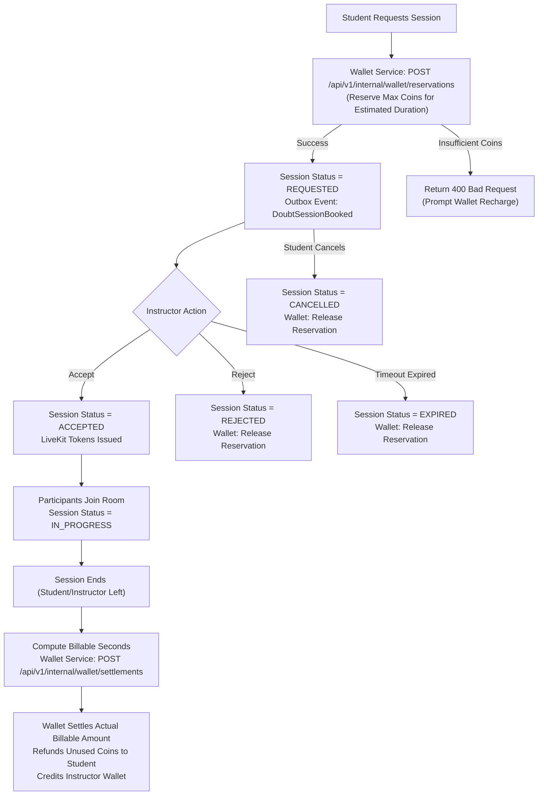

# PeerGeek — Phase 6: Doubt Session Service Extraction Documentation

## 1. Executive Summary & Extraction Overview

As part of Phase 6 of the PeerGeek microservices migration, the Doubt Session bounded context has been extracted from the monolith into an independent, production-grade Spring Boot microservice located in `doubt-session-service/`.

The service owns real-time 1-on-1 doubt clearing session lifecycle management, LiveKit room token generation, session scheduling, GeekCoins billing coordination (wallet reservation, settlement, and release), course doubt settings, and instructor availability.

### Service Profile

| Property | Value |
|---|---|
| Service Name | `doubt-session-service` |
| Directory | `doubt-session-service/` |
| Dedicated Database Schema | `peergeek_doubt_session` |
| Port | `8092` |
| API Gateway Route | `/api/v1/doubt-sessions/**`, `/api/v1/instructor/doubt-sessions/**`, `/api/v1/instructor/courses/*/doubt-session-settings`, `/api/v1/public/courses/*/doubt-session-availability` |
| Message Broker | Apache Kafka (`kafka:29092` / `localhost:9092`) |
| Outbox Topic | `peergeek.doubtsession.session-booked.v1` |
| WebRTC Real-Time Provider | LiveKit (`LIVEKIT_API_URL=http://livekit:7880`) |
| Inter-Service Dependencies | `wallet-payment-service` (port 8088), `course-learning-assessment-service` (port 8090) |
| Packaging | Spring Boot 3.4.3 Executable JAR (`target/doubt-session-service-0.0.1-SNAPSHOT.jar`) |
| Container Image | `peergeek-doubt-session-service:latest` |

---

## 2. Dedicated Database Schema & Data Migration

The service maintains schema sovereignty over MySQL schema `peergeek_doubt_session`. Database migrations are managed via Flyway.

### Tables Owned

1. **`course_doubt_session_settings`**: Per-course configuration defining whether 1-on-1 sessions are enabled, hourly coin rate (`hourly_rate_pgc`), and availability windows.
2. **`doubt_sessions`**: Session entities with UUID identifiers, student and instructor IDs, subject/topic, scheduled start and end times, actual connection timestamps, billing metrics (billable seconds, reserved coins, settled coins, refund amount), and lifecycle status (`REQUESTED`, `ACCEPTED`, `REJECTED`, `IN_PROGRESS`, `COMPLETED`, `CANCELLED`, `EXPIRED`).
3. **`outbox_events`**: Transactional outbox table for reliable Kafka event dispatching.

### Historical Data Migration Reconciliation

Data was safely migrated from the monolith schema `peergeek` to `peergeek_doubt_session`:

```sql
INSERT IGNORE INTO peergeek_doubt_session.course_doubt_session_settings SELECT * FROM peergeek.course_doubt_session_settings;
INSERT IGNORE INTO peergeek_doubt_session.doubt_sessions SELECT * FROM peergeek.doubt_sessions;
```

#### Row Count Verification

| Table | Monolith `peergeek` | Target `peergeek_doubt_session` | Reconciliation Status |
|---|---|---|---|
| `course_doubt_session_settings` | 1 | 1 | **100% MATCH** |
| `doubt_sessions` | 0 | 0 | **100% MATCH** |

---

## 3. Real-Time WebRTC Integration (LiveKit)

The Doubt Session Service orchestrates interactive WebRTC video and audio rooms via LiveKit:

### Room & Token Generation
- Room Name Convention: `doubt-session-{sessionUid}`
- Tokens are generated on demand via `LiveKitService` using the platform API Key and API Secret (`LIVEKIT_API_KEY` / `LIVEKIT_API_SECRET`).
- Token grant contains:
  - `identity`: User ID of participant (`String.valueOf(user.getId())`)
  - `name`: Participant display name
  - `roomJoin`: `true`
  - `room`: `doubt-session-{sessionUid}`
  - Permissions: Video publish, audio publish, data publish.

### Join/Leave Tracking & Billable Duration
- Endpoints: Webhook listener `/api/v1/doubt-sessions/webhooks/livekit` receives room participant events (`participant_joined`, `participant_left`).
- When both student and instructor join, session status advances to `IN_PROGRESS`, recording `actual_started_at`.
- When participants disconnect or the session ends, `actual_ended_at` is recorded.
- Billable time is computed to the exact second:
  $$\text{billableSeconds} = \max(0, \text{actualEndedAt} - \text{actualStartedAt})$$
  $$\text{billableCharge} = \frac{\text{billableSeconds}}{3600} \times \text{hourlyRatePgc}$$

---

## 4. Inter-Service Billing Coordination (Wallet Service)

The Doubt Session Service does not mutate wallet ledger balances directly. It orchestrates billing through the dedicated `wallet-payment-service` using secure internal APIs protected by `X-Gateway-Secret`.

### Billing State Machine



### Internal Wallet Endpoints Used
1. **Reservation**: `POST /api/v1/internal/wallet/reservations`
   - Request: `{"userId": studentId, "amount": reservedAmount, "referenceType": "DOUBT_SESSION", "referenceId": sessionUid}`
2. **Settlement**: `POST /api/v1/internal/wallet/settlements`
   - Request: `{"reservationId": reservationId, "actualAmount": actualCharge, "instructorId": instructorId}`
3. **Release**: `POST /api/v1/internal/wallet/reservations/release`
   - Request: `{"reservationId": reservationId, "reason": cancellationReason}`

---

## 5. Transactional Outbox & Kafka Event Reliability

When a session is requested, an outbox record is persisted in `peergeek_doubt_session.outbox_events` in the exact same database transaction as the session insertion.

### Event Flow
- Topic: `peergeek.doubtsession.session-booked.v1`
- Event Type: `DoubtSessionBooked`
- Payload:
```json
{
  "sessionId": "407650e2-a96d-412e-82a0-24ada603e9bc",
  "instructorId": 1,
  "studentId": 2,
  "sessionTitle": "Live Doubt Clearing: React Hooks and State",
  "bookedAt": "2026-11-08T01:30:00Z"
}
```
- Downstream Consumer: `notification-service` consumes this event to create an instant notification alert for the instructor in their notification bell.

---

## 6. Scheduled Lifecycle Automation

`DoubtSessionTimeoutScheduler` runs automatically every 60 seconds:
- Identifies sessions in `REQUESTED` status whose requested start time has passed or exceeded the reservation window.
- Automatically transitions them to `EXPIRED`.
- Calls `WalletServiceClient.releaseReservation` to unfreeze the student's reserved GeekCoins.
- Prevents deadlocked coin balances.

---

## 7. API Surface

### Student Session APIs (`/api/v1/doubt-sessions/**`)
- `POST /api/v1/doubt-sessions/book`: Request a new doubt-clearing session with coin reservation.
- `GET /api/v1/doubt-sessions/{sessionUid}`: Get session details and status.
- `POST /api/v1/doubt-sessions/{sessionUid}/cancel`: Cancel session and release coin reservation.
- `GET /api/v1/doubt-sessions/{sessionUid}/livekit-token`: Obtain LiveKit WebRTC access token.

### Instructor Session APIs (`/api/v1/instructor/doubt-sessions/**`)
- `GET /api/v1/instructor/doubt-sessions/pending`: List incoming pending session requests.
- `POST /api/v1/instructor/doubt-sessions/{sessionUid}/accept`: Accept request and prepare LiveKit room.
- `POST /api/v1/instructor/doubt-sessions/{sessionUid}/reject`: Reject request and release reservation.
- `POST /api/v1/instructor/doubt-sessions/{sessionUid}/end`: End active session, triggering wallet settlement.

### Course Settings & Public Availability
- `GET /api/v1/instructor/courses/{courseId}/doubt-session-settings`: Get instructor doubt settings.
- `PUT /api/v1/instructor/courses/{courseId}/doubt-session-settings`: Update settings (enabled, hourly rate).
- `GET /api/v1/public/courses/{courseId}/doubt-session-availability`: Public check for course availability.

### Webhooks
- `POST /api/v1/doubt-sessions/webhooks/livekit`: LiveKit participant connection lifecycle webhook.

---

## 8. API Gateway Routing & Order Optimization

Spring Cloud Gateway evaluates routes in order. To prevent the broader Course Service route predicate `/api/v1/instructor/**` from capturing Doubt Session requests, Doubt Session routes are placed ahead of Course Service:

### Gateway Configuration (`api-gateway/src/main/resources/application.yml`)
```yaml
- id: doubt-session-service
  uri: ${DOUBT_SESSION_SERVICE_URL:http://localhost:8092}
  predicates:
    - Path=/api/v1/doubt-sessions/**, /api/v1/instructor/doubt-sessions/**, /api/v1/instructor/courses/*/doubt-session-settings, /api/v1/public/courses/*/doubt-session-availability

- id: course-learning-service
  uri: ${COURSE_LEARNING_SERVICE_URL:http://localhost:8090}
  predicates:
    - Path=/api/v1/categories/**, /api/v1/instructor/**, /api/v1/learning/**, /api/v1/certificates/**, /api/v1/admin/certificates/**, /api/v1/admin/courses/**, /api/v1/bookmarks/**, /api/v1/courses/**
```

---

## 9. Verification Evidence & Test Results

### 1. Spring Boot Integration Tests
Executed via Maven Surefire:
```bash
mvnw.cmd test
```
**Results:** `Tests run: 6, Failures: 0, Errors: 0, Skipped: 0`
- `contextLoads`: Context initialization and Flyway migration verification.
- `testBookSession_Success`: Verified wallet reservation check, session insertion, and outbox event creation.
- `testAcceptSession_GeneratesLiveKitToken`: Verified instructor session acceptance and LiveKit token generation.
- `testJoinAndLeave_BillableTrackingAndCompletion`: Verified participant join/leave calculation, session completion, and wallet settlement.
- `testCancelSession_ReleasesWalletReservation`: Verified student cancellation and wallet reservation release.
- `testPublicCourseAvailability`: Verified public availability endpoint logic.

### 2. Actuator Health Verification
```bash
curl.exe -s http://localhost:8092/actuator/health
```
**Output:**
```json
{
  "status": "UP",
  "groups": ["liveness", "readiness"],
  "components": {
    "db": { "status": "UP", "details": { "database": "MySQL", "validationQuery": "isValid()" } },
    "diskSpace": { "status": "UP" },
    "livenessState": { "status": "UP" },
    "ping": { "status": "UP" },
    "readinessState": { "status": "UP" }
  }
}
```

### 3. API Gateway End-to-End Routing Verification
```bash
curl.exe -s http://localhost:8081/api/v1/public/courses/1/doubt-session-availability
```
**Output:**
```json
{
  "courseId": 1,
  "enabled": false,
  "available": true,
  "hourlyRatePgc": 750,
  "instructorDisplayName": "Instructor #1",
  "instructorHasActiveSession": false,
  "isEnrolled": false,
  "instructorId": 1,
  "isOwner": false
}
```

### 4. Frontend Vitest Verification
All frontend unit and feature tests were executed:
```bash
cd frontend && npm test
```
**Output:**
```
Test Files  30 passed (30)
     Tests  242 passed (242)
  Duration  131.05s
```
100% of frontend tests continue to pass without regression across all modules.

