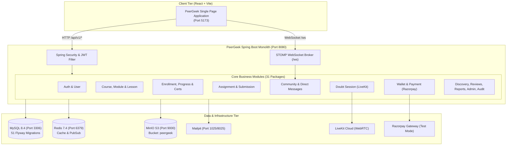

# Document 1: Current Architecture Assessment

## 1. Executive Summary

PeerGeek is currently structured as a modular monolith implemented in **Java 25** using **Spring Boot 4.1.1**, backed by **MySQL 8.4** for relational data persistence, **Redis 7.4** for caching and distributed locks, **MinIO** for S3-compatible object storage, **Mailpit / SMTP** for email delivery, **WebSockets with STOMP** for real-time messaging, and **LiveKit Cloud** for WebRTC audio/video doubt sessions.

The frontend is a single-page application built with **React 19**, **Vite 6**, **Tailwind CSS v4**, and **TanStack React Query**, communicating via REST over `/api/v1` and WebSockets over `/ws`.

While the monolith exhibits thoughtful modular package partitioning under `com.peergeek.*` with loose IDs in several entities (e.g., `userId` and `courseId` stored as numeric primitives rather than object references), it remains tightly coupled at the compilation, transaction, and persistence layers. Services frequently execute cross-domain reads, perform synchronous cross-boundary calls within `@Transactional` boundaries, and rely on monolithic foreign keys and shared database tables.

---

## 2. Infrastructure & Runtime Topology

| Layer | Technology | Current Deployment & Role |
| :--- | :--- | :--- |
| **Backend Runtime** | Java 25.0.4, Spring Boot 4.1.1 | Single JVM monolithic service running on port 8080. |
| **Relational Database** | MySQL 8.4.5 (InnoDB) | Single relational database (`peergeek`) with 51 Flyway migrations (`V0_001` to `V22_006`) and 38 primary tables. |
| **In-Memory Store** | Redis 7.4.2 Alpine | Used for discovery catalog caching, session state, lock handling, and rate limiting. |
| **Object Storage** | MinIO (RELEASE.2025-02-28) | S3-compatible bucket `peergeek` storing lesson PDFs, videos, document resources, course thumbnails, submission files, avatars, and completion certificate PDFs. |
| **Real-time Messaging** | Spring WebSocket (STOMP) | In-memory `SimpleBroker` mounted on `/ws` with destination prefixes `/topic` and `/queue`. |
| **WebRTC Video** | LiveKit Cloud | 1-on-1 audio/video sessions for real-time doubt clearance. |
| **Payments** | Razorpay Test Mode | Gateway integration for PGC GeekCoins wallet recharge via Orders API, Checkout SDK, and Webhooks. |
| **Mail Service** | Mailpit v1.27.8 / JavaMail | Local SMTP server capturing registration verification and password reset emails. |

---

## 3. Comprehensive Inventory of Business Modules

The backend contains **31 packages** under `com.peergeek.*`. Below is an exhaustive audit of each business domain module.

### 3.1. Auth Module (`com.peergeek.auth`)
- **Business Responsibility**: User authentication, registration with email verification OTPs, login, JWT token issuance, session refresh with HTTP-only cookies, password reset workflows, and credential validation.
- **Controllers**: `AuthController` (`POST /api/v1/auth/register`, `/verify-email`, `/resend-verification-otp`, `/login`, `/refresh`, `/logout`, `/forgot-password`, `/verify-reset-otp`, `/reset-password`).
- **Services**: `AuthService`, `AuthOtpService`, `PasswordResetService`.
- **Entities**: `AuthOtpEntity` (`auth_otps`), `PasswordResetOtpEntity` (`password_reset_otps`), `RefreshTokenEntity` (`refresh_tokens`).
- **Repositories**: `AuthOtpRepository`, `PasswordResetOtpRepository`, `RefreshTokenRepository`.
- **Database Tables**: `auth_otps`, `password_reset_otps`, `refresh_tokens`.
- **Direct Upstream Dependencies**: `user` (`UserEntity`, `UserRepository`), `security` (`JwtService`), `audit` (`AuditService`), `config` (`AuthSettings`).
- **Downstream Dependents**: `admin` (`AdminDashboardService`), `user` (`UserService`), `community` (auth validation).
- **External Integrations**: Spring Mail (`JavaMailSender`).

### 3.2. User Module (`com.peergeek.user`)
- **Business Responsibility**: User account lifecycle, student/instructor profile management, biography, skills, interests, social links, education credentials, project showcase, avatar upload/download, and user mode switching (`STUDENT` vs `INSTRUCTOR`).
- **Controllers**: `UserController` (`/api/v1/users/**`), `InstructorStudentController` (`/api/v1/instructor/courses/{courseId}/students/{studentId}`).
- **Services**: `UserService`.
- **Entities**: `UserEntity` (`users`), `UserEducationEntity` (`user_educations`), `UserProjectEntity` (`user_projects`).
- **Repositories**: `UserRepository`, `UserEducationRepository`, `UserProjectRepository`.
- **Database Tables**: `users`, `user_educations`, `user_projects`.
- **Direct Upstream Dependencies**: `file` (`ObjectStorageService`), `audit` (`AuditService`), `course` (`CourseRepository`), `enrollment` (`EnrollmentRepository`, `CourseProgressRepository`), `assignment` (`AssignmentRepository`), `submission` (`SubmissionRepository`), `review` (`ReviewRepository`).
- **Downstream Dependents**: Central entity referenced by nearly every module in the monolith.
- **External Integrations**: MinIO (user avatars).

### 3.3. Course Module (`com.peergeek.course`)
- **Business Responsibility**: Course authoring, catalog categorization, course metadata (title, summary, difficulty, prerequisites, topics), draft/publishing state transitions, and instructor course outline management.
- **Controllers**: `CourseController` (`/api/v1/instructor/courses/**`), `CategoryController` (`/api/v1/categories`), `CoursePreviewController` (`/api/v1/instructor/courses/{courseId}/preview`).
- **Services**: `CourseService`, `CategoryService`, `CoursePublishingService`, `CoursePreviewService`, `CourseStructureQueryService`.
- **Entities**: `CourseEntity` (`courses`), `CategoryEntity` (`categories`), `CourseTopicEntity` (`course_topics`).
- **Repositories**: `CourseRepository`, `CategoryRepository`, `CourseTopicRepository`.
- **Database Tables**: `courses`, `categories`, `course_topics`.
- **Direct Upstream Dependencies**: `user` (`UserEntity`, `UserRepository`), `module` (`ModuleRepository`), `lesson` (`LessonRepository`), `readiness` (`ReadinessService`), `audit` (`AuditService`).
- **Downstream Dependents**: `enrollment`, `module`, `lesson`, `file`, `readiness`, `discovery`, `doubtsession`, `certificate`, `review`, `report`, `bookmark`.
- **External Integrations**: None.

### 3.4. Module Domain (`com.peergeek.module`)
- **Business Responsibility**: Structural course organization into sequential learning modules, module title, description, ordering, and re-indexing.
- **Controllers**: `ModuleController` (`POST`, `PATCH`, `DELETE`, `PUT /api/v1/instructor/courses/{courseId}/modules/**`).
- **Services**: `ModuleService`.
- **Entities**: `ModuleEntity` (`course_modules`).
- **Repositories**: `ModuleRepository`.
- **Database Tables**: `course_modules`.
- **Direct Upstream Dependencies**: `course` (`CourseService`, `CourseEntity`).
- **Downstream Dependents**: `course`, `lesson`, `enrollment`, `readiness`.

### 3.5. Lesson Domain (`com.peergeek.lesson`)
- **Business Responsibility**: Individual learning unit creation, video/reading content payload management, duration tracking, sequence reordering, and rich text/markdown storage.
- **Controllers**: `LessonController` (`/api/v1/instructor/modules/{moduleId}/lessons/**`, `/api/v1/instructor/lessons/{lessonId}/**`).
- **Services**: `LessonService`.
- **Entities**: `LessonEntity` (`lessons`), `LessonContentEntity` (`lesson_contents`).
- **Repositories**: `LessonRepository`, `LessonContentRepository`.
- **Database Tables**: `lessons`, `lesson_contents`.
- **Direct Upstream Dependencies**: `module` (`ModuleEntity`, `ModuleRepository`), `course` (`CourseService`).
- **Downstream Dependents**: `enrollment`, `file`, `readiness`, `note`, `bookmark`.

### 3.6. File / Resource Module (`com.peergeek.file`)
- **Business Responsibility**: Presigned S3 URL generation for upload and download, multi-part asset confirmation, resource metadata management (MIME type, byte size, checksum, processing state), lesson attachments, and course thumbnails.
- **Controllers**: `InstructorResourceController` (`/api/v1/instructor/lessons/{lessonId}/resources/**`, `/api/v1/instructor/courses/{courseId}/thumbnail/**`), `ResourceUploadController` (`/api/v1/instructor/resources/**`).
- **Services**: `InstructorResourceService`, `ResourceUploadService`, `ResourceDownloadService`, `ResourceAccessService`, `ResourceReconciliationService`, `CourseThumbnailService`, `ObjectStorageService`.
- **Entities**: `ResourceEntity` (`resources`), `LessonExpectedResourceEntity` (`lesson_expected_resources`).
- **Repositories**: `ResourceRepository`, `LessonExpectedResourceRepository`.
- **Database Tables**: `resources`, `lesson_expected_resources`.
- **Direct Upstream Dependencies**: `course` (`CourseStructureQueryService`), `user` (`UserRepository`), `config` (`S3Config`).
- **Downstream Dependents**: `course`, `enrollment`, `submission`, `certificate`, `user`.
- **External Integrations**: MinIO / S3 SDK (`software.amazon.awssdk.services.s3.S3Client`).

### 3.7. Enrollment & Learning Progress Module (`com.peergeek.enrollment`)
- **Business Responsibility**: Student enrollment in published courses, withdrawal, lesson visit tracking, lesson completion toggling, aggregate course progress percentage computation, and course completion milestone detection.
- **Controllers**: `LearningEnrollmentController` (`/api/v1/learning/courses/{courseId}/enroll**`), `LearningContentController` (`/api/v1/learning/courses/{courseId}/**`, `/continue`).
- **Services**: `EnrollmentService`, `ProgressService`, `LearningContentService`, `DefaultEnrollmentQueryService`.
- **Entities**: `EnrollmentEntity` (`enrollments`), `LessonProgressEntity` (`lesson_progress`), `CourseProgressEntity` (`course_progress`).
- **Repositories**: `EnrollmentRepository`, `LessonProgressRepository`, `CourseProgressRepository`.
- **Database Tables**: `enrollments`, `lesson_progress`, `course_progress`.
- **Direct Upstream Dependencies**: `course` (`CourseStructureQueryService`), `user` (`UserService`), `file` (`ResourceRepository`, `ResourceAccessService`, `ObjectStorageService`), `audit` (`AuditService`).
- **Downstream Dependents**: `certificate`, `analytics`, `doubtsession`, `review`, `admin`.
- **Domain Events Emitted**: `LearnerEnrolledEvent`, `LearnerWithdrawnEvent`, `LessonCompletedEvent`.

### 3.8. Assignment & Question Module (`com.peergeek.assignment`)
- **Business Responsibility**: Instructor authoring of assignments, question types (`MULTIPLE_CHOICE`, `SINGLE_CHOICE`, `TEXT`, `FILE_UPLOAD`), passing scores, deadlines, mandatory vs optional designations, and assignment publishing.
- **Controllers**: `InstructorAssignmentController` (`/api/v1/instructor/courses/{courseId}/assignments/**`), `LearnerAssignmentController` (`/api/v1/learning/courses/{courseId}/assignments/**`).
- **Services**: `InstructorAssignmentService`, `LearnerAssignmentService`.
- **Entities**: `AssignmentEntity` (`assignments`), `AssignmentQuestionEntity` (`assignment_questions`).
- **Repositories**: `AssignmentRepository`, `AssignmentQuestionRepository`.
- **Database Tables**: `assignments`, `assignment_questions`.
- **Direct Upstream Dependencies**: `course` (`CourseStructureQueryService`), `enrollment` (`EnrollmentQueryService`), `submission` (`SubmissionRepository`), `audit` (`AuditService`).
- **Downstream Dependents**: `submission`, `certificate`, `analytics`.
- **Domain Events Emitted**: `AssignmentPublishedEvent`.

### 3.9. Submission & Grading Module (`com.peergeek.submission`)
- **Business Responsibility**: Student assignment attempts, question answering, file attachment uploads, submission finalization, automated grading for objective questions, instructor manual grading, feedback entry, and pass/fail evaluation.
- **Controllers**: Handled via `InstructorAssignmentController` and `LearnerAssignmentController`.
- **Services**: `LearnerSubmissionService`, `InstructorGradingService`, `SubmissionFileService`.
- **Entities**: `SubmissionEntity` (`submissions`), `SubmissionAnswerEntity` (`submission_answers`), `SubmissionFileEntity` (`submission_files`).
- **Repositories**: `SubmissionRepository`, `SubmissionAnswerRepository`, `SubmissionFileRepository`.
- **Database Tables**: `submissions`, `submission_answers`, `submission_files`.
- **Direct Upstream Dependencies**: `assignment` (`AssignmentRepository`, `AssignmentQuestionRepository`), `course` (`CourseStructureQueryService`), `enrollment` (`EnrollmentQueryService`), `file` (`ObjectStorageService`), `user` (`UserService`).
- **Downstream Dependents**: `assignment`, `certificate`, `analytics`.
- **Domain Events Emitted**: `SubmissionSubmittedEvent`, `SubmissionGradedEvent`.

### 3.10. Certificate Module (`com.peergeek.certificate`)
- **Business Responsibility**: Automated certificate issuance upon 100% course and mandatory assignment completion, cryptographic verification code generation, PDF generation using OpenPDF, S3 storage, student certificate download, and admin revocation/reconciliation.
- **Controllers**: `CertificateController` (`/api/v1/certificates/**`), `AdminCertificateController` (`/api/v1/admin/certificates/**`).
- **Services**: `CertificateService`, `CertificateEligibilityService`, `CertificateCompletionListener`.
- **Entities**: `CertificateEntity` (`certificates`).
- **Repositories**: `CertificateRepository`.
- **Database Tables**: `certificates`.
- **Direct Upstream Dependencies**: `enrollment` (`EnrollmentRepository`, `ProgressService`), `course` (`CourseStructureQueryService`), `user` (`UserRepository`), `assignment` (`AssignmentRepository`), `submission` (`SubmissionRepository`), `file` (`ObjectStorageService`), `notification` (`NotificationService`).
- **Downstream Dependents**: None (terminal consumer).
- **Domain Events Listened To**: `LessonCompletedEvent`.

### 3.11. Wallet Subsystem (`com.peergeek.wallet`)
- **Business Responsibility**: GeekCoins ledger maintenance, balance tracking, fund reservations for pending doubt sessions, fund releases upon session cancellation, session settlement payouts to instructors, and transactional ledger audits.
- **Controllers**: `WalletController` (`GET /api/v1/wallet/balance`, `/me`, `/transactions`).
- **Services**: `WalletService`.
- **Entities**: `WalletEntity` (`wallets`), `WalletTransactionEntity` (`wallet_transactions`).
- **Repositories**: `WalletRepository`, `WalletTransactionRepository`.
- **Database Tables**: `wallets`, `wallet_transactions`.
- **Direct Upstream Dependencies**: `user` (`UserRepository`, `UserEntity`).
- **Downstream Dependents**: `doubtsession` (`DoubtSessionService`), `referral` (`ReferralService`), `payment` (`PaymentService`).

### 3.12. Payment Subsystem (`com.peergeek.payment`)
- **Business Responsibility**: Real-money wallet top-up via Razorpay Test Mode, package catalog management (100, 250, 500, 1000 PGC), Razorpay order creation, constant-time HMAC-SHA256 signature verification, idempotent wallet crediting, and webhook processing (`payment.captured`, `order.paid`, `payment.failed`).
- **Controllers**: `PaymentController` (`/api/v1/wallet/topup/**`), `RazorpayWebhookController` (`POST /api/v1/payments/razorpay/webhook`).
- **Services**: `PaymentService`, `RazorpayService`, `RazorpaySignatureVerifier`, `RechargePricingService`, `RazorpaySettings`.
- **Entities**: `PaymentOrderEntity` (`payment_orders`).
- **Repositories**: `PaymentOrderRepository`.
- **Database Tables**: `payment_orders`.
- **Direct Upstream Dependencies**: `wallet` (`WalletService`), `user` (`UserRepository`).
- **External Integrations**: Razorpay Orders API, Razorpay Webhook Engine, Razorpay Checkout SDK.

### 3.13. Doubt Session Module (`com.peergeek.doubtsession`)
- **Business Responsibility**: 1-on-1 real-time doubt clearing between students and course instructors, instructor availability schedules, hourly rate configuration in GeekCoins, booking requests, wallet reservation, LiveKit WebRTC room creation, JWT access token generation, session lifecycle state machine (`REQUESTED`, `SCHEDULED`, `ACTIVE`, `COMPLETED`, `CANCELLED`, `REJECTED`), and settlement payouts.
- **Controllers**: `DoubtSessionController` (`/api/v1/doubt-sessions/**`), `InstructorDoubtSessionController` (`/api/v1/instructor/courses/{courseId}/doubt-session-settings/**`), `LiveKitWebhookController` (`/api/v1/doubt-sessions/webhook`).
- **Services**: `DoubtSessionService`, `LiveKitService`.
- **Entities**: `DoubtSessionEntity` (`doubt_sessions`), `CourseDoubtSessionSettingsEntity` (`course_doubt_session_settings`).
- **Repositories**: `DoubtSessionRepository`, `CourseDoubtSessionSettingsRepository`.
- **Database Tables**: `doubt_sessions`, `course_doubt_session_settings`.
- **Direct Upstream Dependencies**: `course` (`CourseRepository`), `user` (`UserRepository`), `enrollment` (`EnrollmentRepository`), `wallet` (`WalletService`), `notification` (`NotificationService`).
- **External Integrations**: LiveKit Cloud Server SDK / REST Webhooks.

### 3.14. Community Module (`com.peergeek.community`)
- **Business Responsibility**: Discussion forums, post creation, threaded comments, user `@mentions`, domain-specific group chat rooms linked to categories, global campus live chat, user chat blocking/moderation, and real-time STOMP broadcasting.
- **Controllers**: `CommunityController` (`/api/v1/community/**`), `DomainCommunityController` (`/api/v1/domains/**`), `GlobalCommunityController` (`/api/v1/community/global/**`), `AdminGlobalCommunityController` (`/api/v1/admin/community/**`), `CommunityWebSocketController` (STOMP destinations `/app/community.global.send`, `/app/community.domain.{slug}.send`).
- **Services**: `CommunityPostService`, `CommunityCommentService`, `DomainCommunityService`, `GlobalCommunityService`, `CommunityMentionService`, `CommunityRealtimeService`.
- **Entities**: `CommunityPostEntity` (`community_posts`), `CommunityCommentEntity` (`community_comments`), `CommunityMentionEntity` (`community_mentions`), `DomainCommunityEntity` (`domain_communities`), `DomainCommunityMembershipEntity` (`domain_community_memberships`), `DomainChatMessageEntity` (`domain_chat_messages`), `GlobalCommunityMessageEntity` (`global_community_messages`), `GlobalCommunityBlockEntity` (`global_community_blocks`).
- **Repositories**: 8 Spring Data JPA repositories.
- **Database Tables**: 8 relational tables.
- **Direct Upstream Dependencies**: `user` (`UserRepository`), `course` (`CategoryRepository`), `notification` (`NotificationService`).
- **External Integrations**: Spring STOMP WebSocket Message Broker.

### 3.15. Direct Messaging Module (`com.peergeek.directmessage`)
- **Business Responsibility**: Private 1-on-1 chat between users, conversation establishment, message history, read receipt state tracking, real-time message delivery over STOMP, and unread notification counts.
- **Controllers**: `DirectMessageController` (`/api/v1/direct-messages/**`), `CommunityWebSocketController` (`/app/direct.{conversationId}.send`).
- **Services**: `DirectMessageService`, `DirectConversationService`.
- **Entities**: `DirectConversationEntity` (`direct_conversations`), `DirectMessageEntity` (`direct_messages`), `DirectParticipantReadStateEntity` (`direct_participant_read_state`).
- **Repositories**: `DirectConversationRepository`, `DirectMessageRepository`, `DirectParticipantReadStateRepository`.
- **Database Tables**: `direct_conversations`, `direct_messages`, `direct_participant_read_state`.
- **Direct Upstream Dependencies**: `user` (`UserRepository`), `security` (`CurrentUserProvider`).

### 3.16. Notification Module (`com.peergeek.notification`)
- **Business Responsibility**: In-app notifications, unread count tracking, marking notifications as read, and dispatching alert emails via SMTP.
- **Controllers**: `NotificationController` (`/api/v1/notifications/**`).
- **Services**: `NotificationService`, `NotificationEventListener`.
- **Entities**: `NotificationEntity` (`notifications`).
- **Repositories**: `NotificationRepository`.
- **Database Tables**: `notifications`.
- **Direct Upstream Dependencies**: `user` (`UserRepository`), Spring Mail.
- **Downstream Dependents**: `doubtsession`, `certificate`, `referral`, `community`.
- **Domain Events Listened To**: Internal application events.

### 3.17. Referral Module (`com.peergeek.referral`)
- **Business Responsibility**: Unique invitation link generation, referral code validation during student registration, reward disbursement (100 PGC to inviter, 50 PGC welcome bonus to invitee) upon qualification, and daily invitation rate limiting.
- **Controllers**: `ReferralController` (`/api/v1/referrals/**`).
- **Services**: `ReferralService`.
- **Entities**: `ReferralEntity` (`referrals`).
- **Repositories**: `ReferralRepository`.
- **Database Tables**: `referrals`.
- **Direct Upstream Dependencies**: `user` (`UserRepository`), `wallet` (`WalletService`), `notification` (`NotificationService`).

### 3.18. Discovery & Search Module (`com.peergeek.discovery`)
- **Business Responsibility**: Full-text course search, category-based browsing, popular course ranking, enrolled learner counters, rating aggregation, and search index reconciliation.
- **Controllers**: `PublicCourseController` (`/api/v1/public/courses/**`), `PublicCategoryController` (`/api/v1/public/categories`), `AdminDiscoveryController` (`/api/v1/admin/discovery/reindex`).
- **Services**: `PublicCourseQueryService`, `IndexService`, `CourseStatsService`, `DiscoveryCacheService`, `DiscoveryReconciliationService`.
- **Entities**: `PublicCourseIndexEntity` (`public_course_index`), `CoursePublicStatsEntity` (`course_public_stats`).
- **Repositories**: `PublicCourseIndexRepository`, `CoursePublicStatsRepository`, `CourseSearchRepository`.
- **Database Tables**: `public_course_index`, `course_public_stats`.
- **Direct Upstream Dependencies**: `course` (`CourseStructureQueryService`), `user` (`UserService`), `enrollment` (`EnrollmentRepository`), `review` (`ReviewRepository`), Redis.
- **Domain Events Listened To**: `CoursePublishedEvent`, `CourseUnpublishedEvent`, `CourseContentChangedEvent`, `LearnerEnrolledEvent`, `ReviewCreatedEvent`.

### 3.19. Analytics Module (`com.peergeek.analytics`)
- **Business Responsibility**: Instructor dashboard telemetry, course enrollment trends, lesson drop-off rates, assignment submission statistics, and revenue insights.
- **Controllers**: `InstructorAnalyticsController` (`GET /api/v1/instructor/courses/{courseId}/analytics`).
- **Services**: `InstructorAnalyticsService`, `StatsRefresher`.
- **Entities**: None (reads from read models and aggregates on demand).
- **Repositories**: Custom analytical queries.
- **Direct Upstream Dependencies**: `course` (`CourseStructureQueryService`), `enrollment` (`EnrollmentRepository`, `LessonProgressRepository`), `assignment` (`AssignmentRepository`), `submission` (`SubmissionRepository`), `review` (`ReviewRepository`).
- **Domain Events Listened To**: `LessonCompletedEvent`, `LearnerEnrolledEvent`, `SubmissionGradedEvent`.

### 3.20. Admin Module (`com.peergeek.admin`)
- **Business Responsibility**: Platform-wide metrics, system health aggregation, user moderation (ban/unban), course governance (force unpublish/approve), and abuse reports review.
- **Controllers**: `AdminDashboardController` (`/api/v1/admin/**`).
- **Services**: `AdminDashboardService`.
- **Entities**: None (orchestrator service).
- **Direct Upstream Dependencies**: `user` (`UserRepository`), `course` (`CourseRepository`), `enrollment` (`EnrollmentRepository`), `report` (`ReportRepository`), `audit` (`AuditService`).

### 3.21. Reviews, Bookmarks, Notes, Reports, Readiness, and Audit Modules
- **Review (`com.peergeek.review`)**: Course star ratings and student feedback (`reviews` table). Injects `EnrollmentRepository` and `CourseStructureQueryService`.
- **Bookmark (`com.peergeek.bookmark`)**: Personal course and lesson bookmarks (`bookmarks` table). Injects `CourseRepository` and `LessonRepository`.
- **Note (`com.peergeek.note`)**: Private student markdown notes linked to individual lessons (`lesson_notes` table).
- **Report (`com.peergeek.report`)**: User abuse reporting for community posts and inappropriate course content (`community_reports` table).
- **Readiness (`com.peergeek.readiness`)**: Course publishing pre-flight checklist validator. Inspects video accessibility, broken external links, minimum lesson counts, and resource integrity.
- **Audit (`com.peergeek.audit`)**: Platform-wide immutable audit trail (`audit_logs` table) recording actor IDs, actions, and entity targets.

---

## 4. Assessment of Monolith Capabilities & Strengths

1. **Clean Code & Modern Java**: Uses Java 25, records for DTOs, strict pattern matching, and constructor injection throughout.
2. **Flyway Migration Discipline**: 51 database migrations applied sequentially without schema drifts.
3. **Partial Decoupling Already Present**: Many entities (e.g., `EnrollmentEntity`, `CertificateEntity`, `PaymentOrderEntity`, `BookmarkEntity`) deliberately store cross-module references as numeric `Long userId` or `Long courseId` instead of JPA `@ManyToOne` entity graph mappings. This substantially simplifies microservice database extraction.
4. **Spring ApplicationEvents**: Already utilizes asynchronous and synchronous Spring events for notifications, discovery re-indexing, and analytics updates, providing natural seams for Kafka event publication.
5. **Comprehensive Security Baseline**: Unified JWT parsing, stateless filter chain, role-based access control (`STUDENT`, `INSTRUCTOR`, `ADMIN`), and ownership guards.

