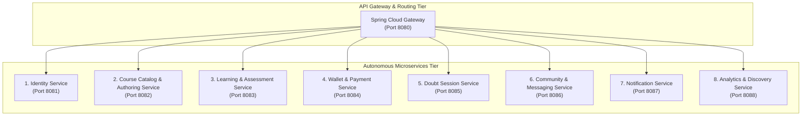

# Document 2: Service Boundary Design

## 1. Domain-Driven Decomposition Strategy

Microservice boundaries in PeerGeek are established based on **Domain-Driven Design (DDD) Bounded Contexts**, data isolation criteria, operational scalability requirements, and team autonomy. 

A critical risk in microservices migrations is "nano-service fragmentation"—splitting cohesive domains into dozens of tiny services that communicate constantly over the network, turning an in-memory method call into an unreliable distributed transaction.

### Guiding Principles:
1. **High Cohesion, Loose Coupling**: Packages that share transaction boundaries or mutate common invariants must reside within the same bounded context.
2. **Autonomous Data Ownership**: Every microservice must own its persistent schema. Direct database access across microservices is strictly prohibited.
3. **Business Capability Alignment**: Services represent distinct business capabilities with independent lifecycles, scalability vectors, and failure blast radiuses.
4. **Pragmatic Consolidation**: Peripheral helper packages (such as `module`, `lesson`, `note`, `bookmark`, `readiness`) are consolidated into their governing domain rather than spun out into isolated services.

---

## 2. Proposed Target Architecture: 8 Core Services

After auditing all 31 monolithic packages, we recommend decomposing PeerGeek into **8 Core Microservices** fronted by an **API Gateway**:

---

## 3. Deep-Dive Evaluation of Service Boundaries

### 3.1. Identity Service (Port 8081)
- **Monolithic Packages Included**: `auth`, `user` (core credentials and profile).
- **Bounded Context**: User identity, credential verification, email OTP verification, password recovery, JWT token lifecycle, user profile metadata, education/project credentials, and role/mode management.
- **Why Separate?**: Authentication is the security boundary for the entire platform. Isolating identity allows independent scaling during traffic spikes (e.g., student registration campaigns) and protects secret keys (`JWT_SECRET`, password hashes).
- **Boundary Decision**:
  - `auth` and `user` must reside in the same service because registration directly provisions `UserEntity` and sets initial user modes.
  - User avatar upload is handled by Identity Service via MinIO presigned URLs.

### 3.2. Course Catalog & Authoring Service (Port 8082)
- **Monolithic Packages Included**: `course`, `module`, `lesson`, `file` (course assets/thumbnails), `readiness`.
- **Bounded Context**: Instructor course authoring, category management, module structuring, lesson content authoring, asset uploading/linking, readiness validation checks, and course draft/published lifecycle.
- **Why Consolidate `course`, `module`, `lesson`, and `readiness`?**:
  - In the monolith, `CourseService`, `ModuleService`, and `LessonService` share tight parent-child tree traversals and database transactions. Splitting `lesson` or `module` into independent microservices would cause severe "chatty" distributed network hops for simple operations like viewing a course outline.
  - `readiness` performs pre-flight integrity audits on course lessons, links, and videos. It belongs inside the authoring boundary.
- **Boundary Decision**:
  - Consolidate `course`, `module`, `lesson`, `readiness`, and instructor resource management into a single `Course Service`.
  - Exposes public course metadata for catalog exploration and protected endpoints for instructor authoring.

### 3.3. Learning & Assessment Service (Port 8083)
- **Monolithic Packages Included**: `enrollment`, `assignment`, `submission`, `certificate`, `note`, `bookmark`.
- **Bounded Context**: Student enrollment, lesson visit tracking, course progress computation, assignment taking, automated and manual grading, certificates of completion, lesson personal notes, and bookmarks.
- **Critical Evaluation: Should Assessment be an independent microservice?**:
  - **Audit Finding**: In the current codebase, `CertificateEligibilityService` checks both `CourseProgress` (100% lessons completed) AND mandatory `Submission` records (passing grade on all required assignments).
  - Furthermore, `LearnerAssignmentService` and `SubmissionFileService` directly check `EnrollmentRepository` before permitting assignment attempts.
  - If Assessment were extracted into a separate service immediately, certificate issuance and assignment access would require 2-phase distributed coordination or fragile cross-service REST queries.
  - **Recommendation**: Keep Assessment (`assignment`, `submission`) co-located with `enrollment` and `certificate` within the **Learning & Assessment Service** during Phases 1–5. Assessment can optionally be cleanly split later via Kafka domain events once asynchronous event contracts stabilize.

### 3.4. Wallet & Payment Service (Port 8084)
- **Monolithic Packages Included**: `wallet`, `payment`.
- **Bounded Context**: PGC GeekCoins ledger, wallet balance queries, reservation and release mechanics, real-money Razorpay order creation, payment signature verification, webhook processing, and transaction audit trail.
- **Why Separate?**: Financial transactions require strict ACID guarantees, pessimistic row-level locking, and high security. Isolating payment logic isolates Razorpay API keys and prevents heavy course browsing traffic from impacting checkout reliability.
- **Boundary Decision**:
  - `payment` and `wallet` are fused into a single microservice. `PaymentService` directly credits `WalletService` within a local database transaction.
  - Webhooks from Razorpay deliver directly to this service.

### 3.5. Doubt Session Service (Port 8085)
- **Monolithic Packages Included**: `doubtsession`.
- **Bounded Context**: 1-on-1 real-time doubt clearing sessions, instructor hourly rate and availability schedules, session booking state machine (`REQUESTED` &rarr; `ACCEPTED` &rarr; `ACTIVE` &rarr; `COMPLETED`), and LiveKit WebRTC room creation and token dispatch.
- **Why Separate?**: Doubt clearance integrates with external WebRTC infrastructure (LiveKit Cloud), handles real-time call states, and operates on an independent scheduling lifecycle.
- **Coordination with Wallet**: Booking requires a synchronous GeekCoins reservation; session completion triggers settlement payouts via asynchronous domain events or resilient REST commands.

### 3.6. Community & Messaging Service (Port 8086)
- **Monolithic Packages Included**: `community` (posts, comments, domain chat, global chat, moderation), `directmessage`, `report`.
- **Bounded Context**: Asynchronous forums, category-specific domain chat, global campus chat, 1-on-1 direct messaging, read receipts, community abuse reporting, user blocking, and real-time STOMP WebSocket broadcasting.
- **Why Consolidate Community and Direct Messaging?**:
  - Both share the underlying WebSocket STOMP infrastructure (`/ws`, `/topic`, `/queue`).
  - Both share abuse reporting (`report`), mention notifications, and real-time message broadcasting logic.
- **Boundary Decision**:
  - Unified Community & Messaging Service managing all social and conversational features.

### 3.7. Notification Service (Port 8087)
- **Monolithic Packages Included**: `notification`.
- **Bounded Context**: Centralized communication dispatch, in-app notification inbox, unread badges, email dispatch via SMTP/Mailpit, and future SMS/Push notifications.
- **Why Separate?**: Notifications are pure side-effects triggered by domain events (e.g., `CourseCompleted`, `DoubtSessionBooked`, `AssignmentGraded`, `PaymentCaptured`). Extracting this service first proves the Kafka event bus without risking core platform capabilities.

### 3.8. Analytics & Discovery Service (Port 8088)
- **Monolithic Packages Included**: `discovery`, `analytics`, `review`.
- **Bounded Context**: Public search index, full-text catalog queries, popular course rankings, student course reviews and ratings, instructor analytics dashboards, enrollment velocity, and drop-off aggregations.
- **Why Combine Discovery and Analytics?**:
  - Both are **read-optimized CQRS projections** built by consuming domain events emitted by the transactional services (Course, Learning, Doubt Session).
  - Both rely on Redis for query caching and pre-computed aggregations.
  - Keeping them together isolates heavy analytic queries and public search crawls from the transactional OLTP databases.

---

## 4. Peripheral Modules Disposition

| Monolithic Package | Target Service | Rationale |
| :--- | :--- | :--- |
| `admin` | **API Gateway + Respective Services** | Administrative operations (e.g. user ban, course unpublish, certificate revoke) belong in their respective business services, authorized via `ROLE_ADMIN` at the API Gateway. |
| `audit` | **Cross-Cutting Shared Library / Kafka Topic** | In the monolith, `AuditService` writes to `audit_logs`. In microservices, audit entries become standardized Kafka events consumed by a centralized log/audit sink. |
| `referral` | **Identity Service / Wallet Service** | Referral links belong to user profiles in Identity; reward disbursement coordinates with Wallet. We co-locate referral business rules inside Identity Service with event-driven wallet rewards. |
| `review` | **Analytics & Discovery Service** | Reviews are public catalog feedback that feed directly into course search ratings and instructor analytics. |
| `bookmark` & `note` | **Learning & Assessment Service** | Personal study aids attached to courses and lessons for enrolled students. |
| `config` | **Spring Cloud Config / Environment Variables** | Split per-service; configurations externalized via environment variables. |
| `security` | **Shared Library (`peergeek-security-starter`)** | Shared JWT verification filter and claims parser distributed across all microservices. |
| `common` & `exception` | **Shared Library (`peergeek-common`)** | Shared API error response models, pagination records, and base domain events. |

