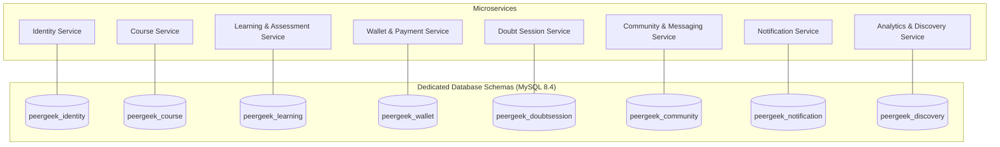
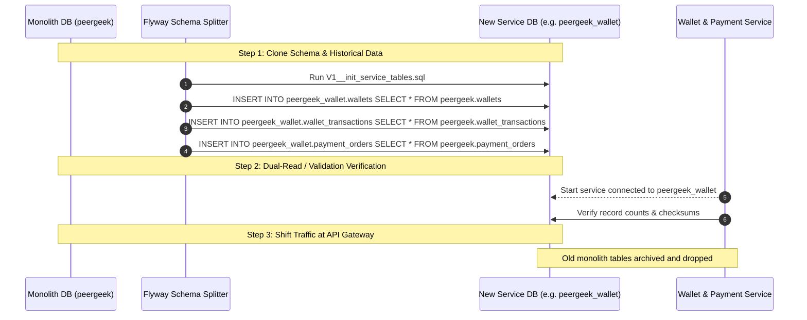

# Document 4: Database Ownership and Migration Plan

## 1. Database Per Service Architecture

The fundamental rule of microservices is **exclusive database ownership**. No service may execute direct SQL reads, writes, joins, or transactions against tables owned by another microservice.

In the initial migration phases, services will use **logical schema separation** on the existing MySQL 8.4 instance (e.g., `peergeek_identity`, `peergeek_course`, etc.) to minimize operational overhead. Once stabilized, these schemas can be migrated to independent MySQL clusters, Amazon RDS, or managed databases without changing application code.



---

## 2. Table Ownership Matrix

Below is the complete allocation of all 38 tables from the existing Flyway migrations (`V0_001` through `V22_006`) to their target databases:

| Database Schema | Owning Service | Assigned Tables | Flyway Source Migrations |
| :--- | :--- | :--- | :--- |
| **`peergeek_identity`** | Identity Service | `users`<br/>`user_educations`<br/>`user_projects`<br/>`auth_otps`<br/>`password_reset_otps`<br/>`refresh_tokens`<br/>`referrals` | `V1_001`, `V1_002`, `V1_003`, `V13_001`, `V15_001`, `V16_001`, `V22_001`, `V22_002` |
| **`peergeek_course`** | Course Service | `categories`<br/>`courses`<br/>`course_topics`<br/>`course_modules`<br/>`lessons`<br/>`lesson_contents`<br/>`resources`<br/>`lesson_expected_resources`<br/>`readiness_runs`<br/>`readiness_issues`<br/>`resource_probe_results`<br/>`link_check_results`<br/>`course_publish_locks` | `V2_001`, `V2_003`, `V2_004`, `V2_005`, `V2_006`, `V2_007`, `V3_001`, `V3_002`, `V4_001`-`V4_005` |
| **`peergeek_learning`** | Learning & Assessment Service | `enrollments`<br/>`lesson_progress`<br/>`course_progress`<br/>`assignments`<br/>`assignment_questions`<br/>`submissions`<br/>`submission_answers`<br/>`submission_files`<br/>`certificates`<br/>`bookmarks`<br/>`lesson_notes`<br/>`course_structure_cache` | `V6_001`, `V6_002`, `V6_003`, `V7_001`-`V7_005`, `V11_001`, `V11_002`, `V22_004`, `V22_005` |
| **`peergeek_wallet`** | Wallet & Payment Service | `wallets`<br/>`wallet_transactions`<br/>`payment_orders` | `V19_001`, `V20_001`, `V22_006` |
| **`peergeek_doubtsession`** | Doubt Session Service | `course_doubt_session_settings`<br/>`doubt_sessions` | `V20_001` |
| **`peergeek_community`** | Community & Messaging Service | `community_posts`<br/>`community_comments`<br/>`community_mentions`<br/>`domain_communities`<br/>`domain_community_memberships`<br/>`domain_chat_messages`<br/>`global_community_messages`<br/>`global_community_blocks`<br/>`direct_conversations`<br/>`direct_messages`<br/>`direct_participant_read_state`<br/>`community_reports` | `V8_002`, `V17_001`, `V18_001`, `V21_001`, `V22_003` |
| **`peergeek_notification`** | Notification Service | `notifications` | `V9_001` |
| **`peergeek_discovery`** | Analytics & Discovery Service | `public_course_index`<br/>`course_public_stats`<br/>`reviews` | `V5_001`, `V5_002`, `V8_001` |

---

## 3. Cross-Database Foreign Key Elimination Strategy

In the monolith, relational constraints (`FOREIGN KEY REFERENCES`) guarantee referential integrity across business modules. In microservices, physical database foreign keys across schemas cannot exist.

### Replacement Pattern:
Physical foreign keys are replaced with **Indexed Logical IDs**:
```sql
-- Monolith (Direct foreign key to users table)
CONSTRAINT fk_wallet_user FOREIGN KEY (user_id) REFERENCES users (id)

-- Microservice Target (Indexed logical primitive)
user_id BIGINT NOT NULL,
INDEX idx_wallet_user_id (user_id)
```

### Critical Foreign Keys to Decouple:

1. **`courses.owner_id` &rarr; `users.id`**:
   - `courses.owner_id` becomes `BIGINT NOT NULL INDEX`.
   - Course authoring checks instructor existence via JWT `sub` and `role` claims at the API Gateway.
2. **`wallets.user_id` &rarr; `users.id`**:
   - `wallets.user_id` becomes `BIGINT NOT NULL UNIQUE INDEX`.
   - When a user registers in Identity Service, Identity publishes `UserRegisteredEvent(userId, email, role)`.
   - Wallet Service consumes the event and provisions an initial `0.00 PGC` wallet automatically.
3. **`certificates.course_id` &rarr; `courses.id`**:
   - `certificates.course_id` becomes `BIGINT NOT NULL INDEX`.
   - Certificate generation reads the course title from the local `course_structure_cache` populated via `CoursePublishedEvent`.
4. **`doubt_sessions.student_id` & `instructor_id` &rarr; `users.id`**:
   - Stored as primitive IDs with indexes. User names and avatars are hydrated on demand from user profile cache or token context.
5. **`direct_messages.conversation_id` & `sender_id` &rarr; `users.id`**:
   - Primitive indexed IDs within `peergeek_community`.

---

## 4. Zero-Downtime Data Migration Plan

To guarantee zero data loss and preserve historical learning records, certificates, and wallet transactions:



### Migration Execution Steps:
1. **Per-Service Flyway Baseline**: Each new microservice repository receives a fresh Flyway migration suite starting from `V1__init.sql`, declaring only its own bounded tables without cross-service foreign keys.
2. **ETL Snapshot Replication**: During the scheduled maintenance window (or via MySQL replication), data is copied from `peergeek` to the respective service database (`INSERT INTO peergeek_wallet.wallets SELECT * FROM peergeek.wallets`).
3. **Sequence & Auto-Increment Alignment**: Auto-increment counters on primary keys (`id`) are reset to match the maximum existing ID (`ALTER TABLE wallets AUTO_INCREMENT = <max_id + 1000>`).
4. **Gateway Routing Cutover**: The API Gateway begins routing all traffic for that domain (e.g., `/api/v1/wallet/**`) to the new service.
5. **Archive Monolith Tables**: Monolith tables are marked read-only, archived to cold storage, and ultimately dropped once the service passes production soak testing.

