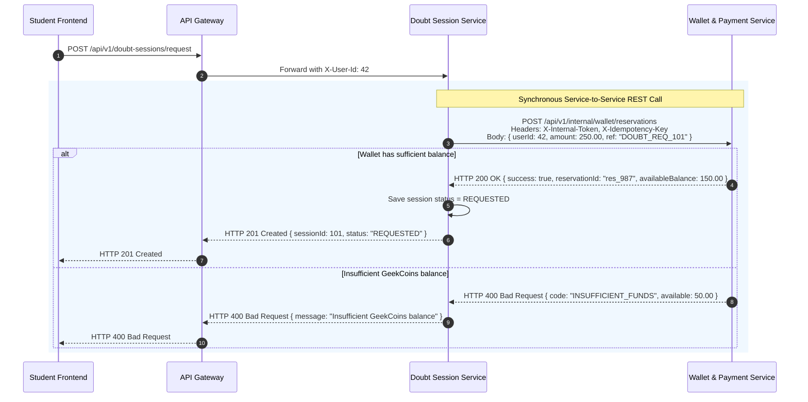

# Document 5: REST API Communication Design

## 1. Principles of Synchronous Microservice Communication

While asynchronous event streaming via Kafka is the primary pattern for side-effects and data replication, **synchronous REST over HTTP/2 or HTTP/1.1** is strictly required when a client or caller must receive an immediate, deterministic success or failure response before proceeding.

### Rules for Synchronous REST:
1. **Never Chain Deep REST Calls**: Service A calling Service B calling Service C calling Service D creates high latency and compounding failure rates ($P_{success} = P_A \times P_B \times P_C \times P_D$). Maximum call depth is 1 hop.
2. **Strict Timeouts**: All synchronous service-to-service calls must configure connect timeouts (maximum 1,000ms) and read timeouts (maximum 2,500ms).
3. **Resilience4j Circuit Breakers**: If downstream calls fail consistently, the circuit breaker opens and executes an immediate fallback or returns a structured error.
4. **Idempotency Keys**: Mutating operations (such as wallet fund reservations) must require an `X-Idempotency-Key` header.
5. **Internal Service Authentication**: Service-to-service internal REST endpoints are mounted under `/api/v1/internal/**`, blocked from external access at the API Gateway, and authenticated via internal signed Service JWTs or mutual TLS.

---

## 2. Service-to-Service Synchronous REST Contracts



---

## 3. Comprehensive Contract Catalogue

### Contract 1: GeekCoins Fund Reservation
- **Calling Service**: Doubt Session Service
- **Receiving Service**: Wallet & Payment Service
- **Endpoint**: `POST /api/v1/internal/wallet/reservations`
- **Business Need**: Doubt session requests must verify and immediately lock student funds. Asynchronous booking would allow students with 0 coins to schedule multiple sessions simultaneously (double-spending).
- **Request Payload**:
  ```json
  {
    "userId": 42,
    "amount": 250.00,
    "referenceType": "DOUBT_SESSION",
    "referenceId": "session_9081",
    "description": "Reservation for 1-hour doubt clearing session"
  }
  ```
- **Response Payload (HTTP 200)**:
  ```json
  {
    "success": true,
    "reservationId": "res_88192",
    "userId": 42,
    "reservedAmount": 250.00,
    "remainingAvailableBalance": 150.00,
    "currency": "PGC"
  }
  ```
- **Error Responses**:
  - `400 Bad Request`: `{ "code": "INSUFFICIENT_FUNDS", "message": "Required: 250.00 PGC, Available: 50.00 PGC" }`
  - `404 Not Found`: `{ "code": "WALLET_NOT_FOUND", "message": "Wallet does not exist for user" }`
- **Timeout**: Connect: 800ms, Read: 2000ms.
- **Circuit Breaker**: 50% failure rate over 10 calls trips circuit breaker; fallback rejects booking with `SERVICE_UNAVAILABLE`.

### Contract 2: Course Structure Snapshot Fallback
- **Calling Service**: Learning & Assessment Service
- **Receiving Service**: Course Catalog & Authoring Service
- **Endpoint**: `GET /api/v1/internal/courses/{courseId}/structure`
- **Business Need**: Used as a fallback if a course was published before Learning Service started or if cache synchronization was missed during certificate generation.
- **Request Parameters**: `courseId` (Path parameter, `Long`).
- **Response Payload (HTTP 200)**:
  ```json
  {
    "courseId": 105,
    "title": "Full-Stack Microservices with Spring Boot & React",
    "instructorId": 7,
    "instructorName": "Dr. Sarah Mitchell",
    "status": "PUBLISHED",
    "totalModules": 8,
    "totalLessons": 42,
    "lessonIds": [1001, 1002, 1003, 1004]
  }
  ```
- **Timeout**: Connect: 1000ms, Read: 2000ms.

### Contract 3: Student Enrollment Verification
- **Calling Service**: Analytics & Discovery Service (Reviews)
- **Receiving Service**: Learning & Assessment Service
- **Endpoint**: `GET /api/v1/internal/learning/enrollment-check?userId={userId}&courseId={courseId}`
- **Business Need**: Prevents un-enrolled spam reviews from being submitted to the public course catalog.
- **Response Payload (HTTP 200)**:
  ```json
  {
    "enrolled": true,
    "enrollmentStatus": "ACTIVE",
    "enrolledAt": "2026-10-15T09:30:00Z",
    "courseProgressPercentage": 68.5
  }
  ```
- **Timeout**: Connect: 500ms, Read: 1500ms.

### Contract 4: Batch User Profile Hydration
- **Calling Service**: Community Service / Doubt Session Service
- **Receiving Service**: Identity Service
- **Endpoint**: `POST /api/v1/internal/users/batch-profiles`
- **Business Need**: Batch hydrates display names, usernames, and avatar URLs for participant lists and message threads.
- **Request Payload**:
  ```json
  {
    "userIds": [1, 2, 42, 89]
  }
  ```
- **Response Payload (HTTP 200)**:
  ```json
  {
    "profiles": [
      {
        "id": 1,
        "username": "devanshtyagi",
        "displayName": "Devansh Tyagi",
        "avatarUrl": "https://storage.peergeek.local/peergeek/avatars/u1.webp",
        "role": "STUDENT"
      },
      {
        "id": 7,
        "username": "smitchell",
        "displayName": "Dr. Sarah Mitchell",
        "avatarUrl": "https://storage.peergeek.local/peergeek/avatars/u7.webp",
        "role": "INSTRUCTOR"
      }
    ]
  }
  ```
- **Timeout**: Connect: 800ms, Read: 2000ms. Cached locally in Redis by caller for 15 minutes.

---

## 4. Resilience & Circuit Breaker Architecture

All inter-service REST clients are implemented using Spring Cloud OpenFeign or `RestClient` with **Resilience4j** configurations:

```yaml
resilience4j.circuitbreaker:
  instances:
    walletService:
      slidingWindowSize: 10
      minimumNumberOfCalls: 5
      failureRateThreshold: 50
      waitDurationInOpenState: 10000ms
      permittedNumberOfCallsInHalfOpenState: 3
    identityService:
      slidingWindowSize: 20
      failureRateThreshold: 40
      waitDurationInOpenState: 5000ms
```

