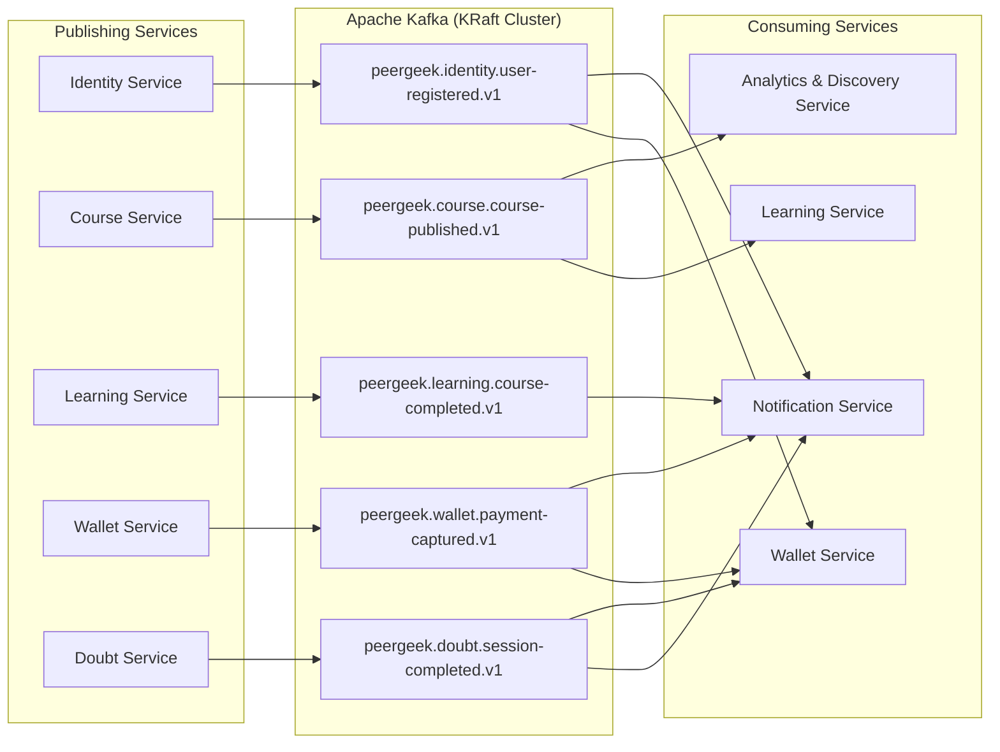

# Document 6: Kafka Event Architecture

## 1. Principles of Business-Event Streaming

Apache Kafka (operating in **KRaft mode**, eliminating ZooKeeper) is PeerGeek's primary backbone for **domain event broadcasting**, **asynchronous state replication**, and **eventual consistency**.

### Architectural Standards:
1. **Facts, Not Commands**: Events represent immutable business facts that occurred in the past (e.g., `CourseCompleted`, `PaymentCaptured`), never imperatives (e.g., `SendEmail`).
2. **Domain-Prefixed Topics**: Topics follow the naming convention `peergeek.<domain>.<entity-event>.v<version>`.
3. **Partitioning Key Strategy**: Every event specifies a deterministic partition key (typically `userId` or `courseId`) ensuring strict in-order message delivery for that entity aggregate.
4. **CloudEvents 1.0 Compliant Envelope**: Standardized envelope with metadata: `id`, `source`, `type`, `time`, `datacontenttype`, and `data`.
5. **Consumer Idempotency**: All consumers must maintain an `idempotency_keys` or `processed_events` table to reject duplicate deliveries safely.



---

## 2. Standardized Event Envelope Format

Every Kafka event in PeerGeek adheres to the CloudEvents standard:

```json
{
  "specversion": "1.0",
  "id": "evt_9b1deb4d-3b7d-4bad-9bdd-2b0d7b3dcb6d",
  "source": "peergeek:service:learning",
  "type": "com.peergeek.learning.course.completed",
  "time": "2026-11-05T08:30:00Z",
  "datacontenttype": "application/json",
  "correlationid": "req_881920-aa91",
  "data": { ... }
}
```

---

## 3. Comprehensive Kafka Event Catalogue

### Event 1: `UserRegistered`
- **Topic**: `peergeek.identity.user-registered.v1`
- **Publisher**: Identity Service
- **Consumers**:
  - `Wallet Service` (group: `wallet-user-provisioner`) &rarr; Automatically provisions initial 0.00 PGC wallet.
  - `Notification Service` (group: `notification-welcome-mailer`) &rarr; Dispatches welcome email.
- **Partition Key**: `userId` (String).
- **Data Schema**:
  ```json
  {
    "userId": 42,
    "email": "student@example.com",
    "displayName": "Alex Rivera",
    "username": "alexr",
    "role": "STUDENT",
    "referralCodeUsed": "REF_99182",
    "registeredAt": "2026-11-05T08:00:00Z"
  }
  ```
- **Ordering**: Per `userId`.
- **Idempotency**: Consumers check `processed_events(event_id)`. Wallet uses unique constraint `UNIQUE (user_id)` on `wallets`.

### Event 2: `CoursePublished`
- **Topic**: `peergeek.course.course-published.v1`
- **Publisher**: Course Service
- **Consumers**:
  - `Analytics & Discovery Service` (group: `discovery-indexer`) &rarr; Builds search document and updates public catalog.
  - `Learning Service` (group: `learning-course-cache`) &rarr; Caches course structure snapshot (modules, lessons) for completions.
- **Partition Key**: `courseId` (String).
- **Data Schema**:
  ```json
  {
    "courseId": 101,
    "title": "Spring Boot & React Microservices",
    "slug": "spring-boot-react-microservices",
    "instructorId": 5,
    "instructorName": "Dr. Elena Rostova",
    "categorySlug": "backend-development",
    "difficulty": "INTERMEDIATE",
    "totalModules": 6,
    "totalLessons": 34,
    "lessonIds": [201, 202, 203],
    "publishedAt": "2026-11-05T08:15:00Z"
  }
  ```

### Event 3: `LessonCompleted`
- **Topic**: `peergeek.learning.lesson-completed.v1`
- **Publisher**: Learning & Assessment Service
- **Consumers**:
  - `Analytics & Discovery Service` (group: `analytics-telemetry-aggregator`) &rarr; Updates drop-off and engagement metrics.
- **Partition Key**: `courseId` (ensures order of completion per course).
- **Data Schema**:
  ```json
  {
    "userId": 42,
    "courseId": 101,
    "lessonId": 204,
    "completedAt": "2026-11-05T08:20:00Z",
    "newCourseProgressPercentage": 65.0
  }
  ```

### Event 4: `CourseCompleted`
- **Topic**: `peergeek.learning.course-completed.v1`
- **Publisher**: Learning & Assessment Service
- **Consumers**:
  - `Notification Service` (group: `notification-congratulations`) &rarr; Dispatches completion email and in-app notification.
  - `Analytics Service` (group: `analytics-completion-stats`) &rarr; Increments course completion metrics.
- **Partition Key**: `userId`.
- **Data Schema**:
  ```json
  {
    "enrollmentId": 901,
    "userId": 42,
    "courseId": 101,
    "courseTitle": "Spring Boot & React Microservices",
    "certificateId": 55,
    "certificateNumber": "PG-2026-X889",
    "completedAt": "2026-11-05T08:30:00Z"
  }
  ```

### Event 5: `AssignmentSubmitted` & `AssignmentGraded`
- **Topics**: `peergeek.learning.assignment-submitted.v1`, `peergeek.learning.assignment-graded.v1`
- **Publisher**: Learning & Assessment Service
- **Consumers**:
  - `Notification Service` &rarr; Informs student of grade results and instructor of pending submissions.
  - `Analytics Service` &rarr; Aggregates pass rates and average scores.
- **Partition Key**: `submissionId`.

### Event 6: `PaymentCaptured`
- **Topic**: `peergeek.wallet.payment-captured.v1`
- **Publisher**: Wallet & Payment Service
- **Consumers**:
  - `Notification Service` (group: `notification-payment-receipt`) &rarr; Sends payment receipt with invoice details.
  - `Analytics Service` (group: `analytics-revenue-tracker`) &rarr; Records financial top-up volume.
- **Partition Key**: `userId`.
- **Data Schema**:
  ```json
  {
    "orderId": 771,
    "userId": 42,
    "razorpayOrderId": "order_Or89X0a1",
    "razorpayPaymentId": "pay_Pr7819Za",
    "amountPaise": 50000,
    "inrAmount": 500.00,
    "pgcAmount": 500.00,
    "newBalance": 650.00,
    "capturedAt": "2026-11-05T08:35:00Z"
  }
  ```

### Event 7: `DoubtSessionCompleted`
- **Topic**: `peergeek.doubt.session-completed.v1`
- **Publisher**: Doubt Session Service
- **Consumers**:
  - `Wallet & Payment Service` (group: `wallet-settlement-processor`) &rarr; Releases reservation and credits instructor payout.
  - `Notification Service` (group: `notification-session-summary`) &rarr; Requests student feedback and sends session summary.
- **Partition Key**: `sessionId`.
- **Data Schema**:
  ```json
  {
    "sessionId": 9081,
    "studentId": 42,
    "instructorId": 7,
    "courseId": 101,
    "rateChargedPgc": 250.00,
    "reservationId": "res_88192",
    "durationMinutes": 60,
    "completedAt": "2026-11-05T09:00:00Z"
  }
  ```

### Event 8: `ReferralRewarded`
- **Topic**: `peergeek.identity.referral-rewarded.v1`
- **Publisher**: Identity Service
- **Consumers**:
  - `Wallet & Payment Service` (group: `wallet-referral-credit`) &rarr; Credits inviter 100 PGC and invitee 50 PGC.
  - `Notification Service` &rarr; Informs users of reward coins.
- **Partition Key**: `inviterId`.

---

## 4. Kafka Topic Configuration & Retention Matrix

| Topic Name | Partitions | Replication | Retention | Cleanup Policy | Justification |
| :--- | :---: | :---: | :---: | :---: | :--- |
| `peergeek.identity.user-registered.v1` | 6 | 3 (Local: 1) | 30 Days | `delete` | Enables re-syncing downstream caches. |
| `peergeek.course.course-published.v1` | 6 | 3 (Local: 1) | 90 Days | `compact` | Keeps latest published course state indefinitely. |
| `peergeek.learning.course-completed.v1` | 6 | 3 (Local: 1) | 365 Days | `delete` | Critical milestone audit trail. |
| `peergeek.wallet.payment-captured.v1` | 6 | 3 (Local: 1) | 730 Days | `delete` | Financial auditing and reconciliation. |
| `peergeek.doubt.session-completed.v1` | 6 | 3 (Local: 1) | 180 Days | `delete` | Doubt clearing settlement history. |
| `peergeek.dead-letter.v1` | 6 | 3 (Local: 1) | 30 Days | `delete` | Central dead-letter queue for poisoned messages. |

---

## 5. Dead-Letter Topic (DLT) & Retry Architecture

Failed Kafka messages follow an exponential backoff retry pattern before routing to a Dead-Letter Topic:

```
[Main Topic] ──(Fails)──► [Retry Topic 1 (5s)] ──(Fails)──► [Retry Topic 2 (30s)] ──(Fails)──► [Dead-Letter Topic]
                                                                                                    │
                                                                                        [Alert & Operator Console]
```
- **Consumer Retry Strategy**: 3 attempts with exponential backoff (1s, 5s, 30s) using Spring Kafka's `DefaultErrorHandler`.
- **Poison Pill Isolation**: After 3 retries, the message is committed and forwarded to `peergeek.dead-letter.v1` with failure headers (`X-Exception-Message`, `X-Exception-Stacktrace`, `X-Original-Topic`).

