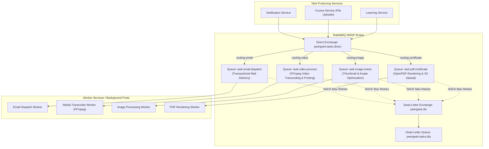

# Document 7: RabbitMQ Architecture

## 1. Differentiating RabbitMQ and Apache Kafka

A central requirement of PeerGeek's target architecture is avoiding redundant broker duplication. Kafka and RabbitMQ have fundamentally different design centers:

| Architectural Dimension | Apache Kafka (Event Streaming) | RabbitMQ (Task Distribution) |
| :--- | :--- | :--- |
| **Primary Pattern** | Publish/Subscribe event log; multiple independent consumer groups stream historical business facts. | Point-to-point Work Queues; competing workers consume and acknowledge discrete tasks. |
| **Message Lifecycle** | Immutable log with long-term retention (days/years); messages persist after consumption. | Transient task buffer; messages are deleted immediately upon consumer acknowledgment (`ack`). |
| **Acknowledgment Model** | Offset commit per partition. | Per-message manual acknowledgment (`basicAck`, `basicNack`, `reject`). |
| **Worker Concurrency** | Concurrency limited by partition count (1 consumer per partition in a group). | Arbitrary worker concurrency via competing consumers with fair dispatch (`prefetch_count`). |
| **Use Case in PeerGeek** | Business facts (`CoursePublished`, `PaymentCaptured`, `CourseCompleted`). | CPU/IO intensive background jobs (Video processing, PDF rendering, Email dispatch). |



---

## 2. Concrete Work Queue Catalogue

### Queue 1: Transactional Email Dispatch (`task.email.dispatch`)
- **Producing Service**: Notification Service
- **Exchange**: `peergeek.tasks.direct` (Type: Direct, Durable)
- **Routing Key**: `task.email.dispatch`
- **Consumer**: Notification Service Background Worker Pool
- **Why RabbitMQ?**:
  - SMTP servers (e.g. Mailpit, SendGrid, Amazon SES) experience transient timeouts, rate limits, and greylisting.
  - RabbitMQ allows individual task rejection (`basicNack`) with requeue delay or Dead Letter routing, preventing one failing email address from stalling an entire Kafka partition.
- **Message Payload**:
  ```json
  {
    "taskId": "task_mail_88190",
    "recipientEmail": "student@example.com",
    "recipientName": "Alex Rivera",
    "templateId": "welcome-student",
    "subject": "Welcome to PeerGeek!",
    "parameters": {
      "verificationOtp": "819204",
      "expiryMinutes": 10
    },
    "correlationId": "req_881920"
  }
  ```
- **Acknowledgment Strategy**: `AcknowledgeMode.MANUAL`. Worker invokes `basicAck` only after SMTP server returns `250 OK`.

### Queue 2: Video Transcoding & Metadata Probing (`task.video.process`)
- **Producing Service**: Course Catalog & Authoring Service
- **Exchange**: `peergeek.tasks.direct`
- **Routing Key**: `task.video.process`
- **Consumer**: Media Processing Worker (Container with FFmpeg installed)
- **Why RabbitMQ?**:
  - Video processing is CPU-bound and can take 2–10 minutes per video.
  - RabbitMQ's `basicQos(prefetchCount = 1)` ensures that expensive video jobs are distributed evenly across available media worker containers without overloading any single CPU node.
- **Message Payload**:
  ```json
  {
    "resourceId": 4091,
    "courseId": 101,
    "lessonId": 204,
    "s3Bucket": "peergeek",
    "s3SourceKey": "uploads/raw/video_4091.mp4",
    "targetResolutions": ["720p", "1080p"],
    "extractThumbnail": true
  }
  ```
- **Processing Time**: Up to 15 minutes. Consumer heartbeat configured to 1800s.

### Queue 3: Thumbnail Generation & Image Optimization (`task.image.resize`)
- **Producing Service**: Course Service (Course thumbnails) / Identity Service (User avatars)
- **Exchange**: `peergeek.tasks.direct`
- **Routing Key**: `task.image.resize`
- **Consumer**: Media Processing Worker
- **Message Payload**:
  ```json
  {
    "sourceBucket": "peergeek",
    "sourceKey": "avatars/raw/user_42.jpg",
    "destinationKey": "avatars/optimized/user_42.webp",
    "maxWidth": 400,
    "maxHeight": 400,
    "outputFormat": "WEBP",
    "quality": 85
  }
  ```

### Queue 4: Certificate PDF Generation (`task.pdf.certificate`)
- **Producing Service**: Learning & Assessment Service
- **Exchange**: `peergeek.tasks.direct`
- **Routing Key**: `task.pdf.certificate`
- **Consumer**: Learning Service PDF Worker Pool
- **Why RabbitMQ?**:
  - Offloads heavy OpenPDF document layout, font parsing, and S3 multipart upload from the HTTP request thread when a student completes a lesson.
- **Message Payload**:
  ```json
  {
    "certificateId": 55,
    "certificateNumber": "PG-2026-X889",
    "verificationCode": "V-98B1-7A",
    "studentName": "Alex Rivera",
    "courseTitle": "Spring Boot & React Microservices",
    "instructorName": "Dr. Elena Rostova",
    "issueDate": "2026-11-05T08:30:00Z"
  }
  ```

---

## 3. Queue Configuration, Dead-Letter Exchange (DLX) & Retries

All queues are declared as durable with a dead-letter exchange policy:

```yaml
spring.rabbitmq.listener.simple:
  acknowledge-mode: manual
  prefetch: 5
  retry:
    enabled: true
    initial-interval: 2000ms
    max-interval: 30000ms
    multiplier: 2.0
    max-attempts: 3
```

### Dead-Letter Configuration (x-dead-letter-exchange):
```
Queue: task.email.dispatch
  Arguments:
    x-dead-letter-exchange: peergeek.dlx
    x-dead-letter-routing-key: dead.task.email
    x-message-ttl: 86400000 (24 hours)

Queue: peergeek.tasks.dlq
  Bound To: peergeek.dlx with '#'
```

- If a worker crashes or calls `basicNack(requeue = false)` after exhausting retries, RabbitMQ automatically routes the task to `peergeek.tasks.dlq` for operator investigation.

