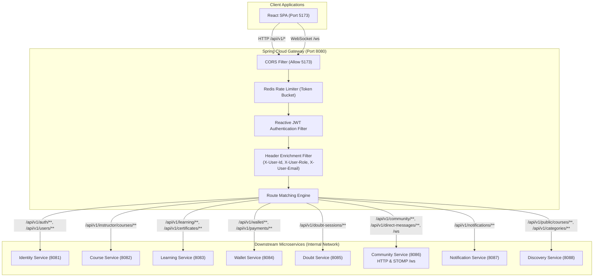
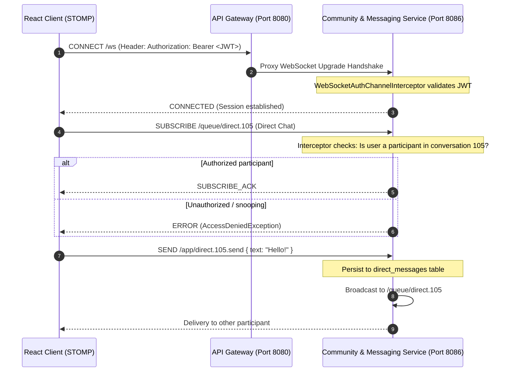

# Document 8: Gateway, Security and WebSocket Design

## 1. API Gateway Architecture (Spring Cloud Gateway)

PeerGeek introduces **Spring Cloud Gateway** (built on Spring WebFlux, Project Reactor, and Netty) as the unified edge router. The Gateway acts as the single point of entry for all external traffic on port **8080**, terminating TLS in production and preserving the existing frontend API contract.

---

## 2. Gateway Route Mapping Table

| Path Pattern | Target Microservice | Security Policy | Rate Limit (req/sec) |
| :--- | :--- | :--- | :---: |
| `/api/v1/auth/**` | `http://identity-service:8081` | Public (except `/logout`) | 10 req/s per IP |
| `/api/v1/users/**` | `http://identity-service:8081` | Authenticated (Public for `/users/*/public`) | 30 req/s per user |
| `/api/v1/instructor/courses/**` | `http://course-service:8082` | `ROLE_INSTRUCTOR`, `ROLE_ADMIN` | 50 req/s per user |
| `/api/v1/learning/**` | `http://learning-service:8083` | Authenticated | 100 req/s per user |
| `/api/v1/certificates/**` | `http://learning-service:8083` | Authenticated (Public for `/verify/*`) | 30 req/s per user |
| `/api/v1/wallet/**` | `http://wallet-service:8084` | Authenticated | 20 req/s per user |
| `/api/v1/payments/razorpay/webhook` | `http://wallet-service:8084` | Public (Signature Verified by Service) | 100 req/s per IP |
| `/api/v1/doubt-sessions/**` | `http://doubtsession-service:8085`| Authenticated | 30 req/s per user |
| `/api/v1/community/**` | `http://community-service:8086` | Authenticated (Public for preview) | 50 req/s per user |
| `/api/v1/direct-messages/**` | `http://community-service:8086` | Authenticated | 50 req/s per user |
| `/api/v1/notifications/**` | `http://notification-service:8087` | Authenticated | 30 req/s per user |
| `/api/v1/public/**` | `http://discovery-service:8088` | Public | 200 req/s per IP |
| `/ws/**` | `ws://community-service:8086` | WebSocket Upgrade (STOMP Auth) | Unlimited (Conn based) |

---

## 3. Authentication & Defense-in-Depth Identity Propagation

### 3.1. Edge JWT Validation
1. Client sends `Authorization: Bearer <jwt-token>` on HTTP requests.
2. Spring Cloud Gateway's `JwtAuthenticationGatewayFilter` parses the token using the public key / secret.
3. If token is invalid or expired, Gateway returns `401 Unauthorized` immediately, shielding downstream services from invalid traffic.
4. If token is valid, Gateway enriches the downstream request headers:
   - `X-User-Id: 42`
   - `X-User-Role: STUDENT`
   - `X-User-Email: student@peergeek.com`
   - `X-Correlation-Id: req_99182a-bb01`

### 3.2. Downstream Service Authorization: Defense-in-Depth
- **Anti-Pattern to Avoid**: Blindly trusting incoming headers from any network source allows an attacker who penetrates the internal network to spoof `X-User-Id: 1` and `X-User-Role: ADMIN`.
- **PeerGeek Defense-in-Depth Architecture**:
  1. Downstream services use a shared security library (`peergeek-security-starter`).
  2. The Gateway cryptographically signs the forwarded identity using an internal HMAC key or Service Private Key in header `X-PeerGeek-Internal-Signature: <hmac-signature>`.
  3. Alternatively, downstream services continue inspecting the original signed `Authorization: Bearer <jwt>` header passed through by the Gateway.
  4. Each service validates domain-level authorization locally: e.g. `OwnershipGuard` verifies that user 42 genuinely owns the course or submission being mutated.

---

## 4. WebSocket & Real-Time STOMP Architecture

PeerGeek currently powers Global Campus Chat, Domain Community Chat, and 1-on-1 Direct Messaging through Spring STOMP over WebSockets (`/ws`).

### 4.1. WebSocket Termination & Routing Strategy
- **Evaluation**: Should WebSockets terminate at the API Gateway or route through to Community Service?
- **Decision**: **Spring Cloud Gateway WebSocket Proxying**:
  - Spring Cloud Gateway natively supports reactive WebSocket proxying over Netty (`ws://community-service:8086/ws`).
  - The React frontend connects to `ws://localhost:8080/ws` identically to today.
  - Gateway handles connection rate limiting and TLS termination; Community Service maintains the STOMP session state, channel subscriptions, and broadcasting.

### 4.2. STOMP Channel Authorization Flow

- **Reconnection Handling**: If a network interruption occurs, the React client automatically reconnects with its refresh token; STOMP interceptor validates the fresh token upon `CONNECT`.

