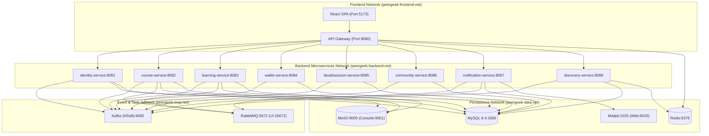

# Document 9: Infrastructure and Deployment Design

## 1. Local Development Topology & Docker Compose Blueprint

PeerGeek's distributed architecture is designed to run seamlessly in local development using a modular Docker Compose architecture. Developers can launch infrastructure prerequisites independently or run the entire suite using Docker Compose profiles.



---

## 2. Port Allocation Table

| Container Name | Service | Internal Port | Host Port | Purpose |
| :--- | :--- | :---: | :---: | :--- |
| `peergeek-frontend` | React SPA (Vite) | 5173 | **5173** | Student & Instructor Web App |
| `peergeek-gateway` | Spring Cloud Gateway | 8080 | **8080** | Unified Edge Router & Reverse Proxy |
| `peergeek-identity-svc` | Identity Service | 8081 | **8081** | Auth, Profile & Credentials |
| `peergeek-course-svc` | Course Catalog & Authoring | 8082 | **8082** | Course Authoring & Modules |
| `peergeek-learning-svc` | Learning & Assessment | 8083 | **8083** | Progress, Assignments, Certificates |
| `peergeek-wallet-svc` | Wallet & Payment | 8084 | **8084** | GeekCoins & Razorpay Integration |
| `peergeek-doubt-svc` | Doubt Session | 8085 | **8085** | 1-on-1 Sessions & LiveKit |
| `peergeek-community-svc`| Community & Messaging | 8086 | **8086** | Forums, Chat & STOMP /ws |
| `peergeek-notif-svc` | Notification Service | 8087 | **8087** | In-app & Email Alerts |
| `peergeek-discovery-svc`| Analytics & Discovery | 8088 | **8088** | Search, Reviews, Dashboards |
| `peergeek-kafka` | Apache Kafka (KRaft) | 9092 | **9092** | Business Event Streaming |
| `peergeek-rabbitmq` | RabbitMQ + Management | 5672 / 15672| **5672 / 15672** | Background Work Queues |
| `peergeek-mysql` | MySQL 8.4 Server | 3306 | **3306** | Dedicated Schema Persistence |
| `peergeek-redis` | Redis 7.4 Server | 6379 | **6379** | Cache, Session & Token Buckets |
| `peergeek-minio` | MinIO Object Storage | 9000 / 9001 | **9000 / 9001** | S3 Asset Storage & Console |
| `peergeek-mailpit` | Mailpit Mock SMTP | 1025 / 8025 | **1025 / 8025** | Local Email Testing & Web UI |

---

## 3. Docker Compose Configuration Structure

Below is the proposed compose file structure:

```yaml
version: '3.8'

networks:
  peergeek-frontend-net:
    driver: bridge
  peergeek-backend-net:
    driver: bridge
  peergeek-data-net:
    driver: bridge

volumes:
  mysql-data:
  kafka-data:
  rabbitmq-data:
  redis-data:
  minio-data:

services:
  # Infrastructure Services
  mysql:
    image: mysql:8.4.5
    container_name: peergeek-mysql
    networks: [peergeek-data-net]
    ports: ["3306:3306"]
    environment:
      MYSQL_ROOT_PASSWORD: ${MYSQL_ROOT_PASSWORD}
    volumes: [mysql-data:/var/lib/mysql]
    healthcheck:
      test: ["CMD-SHELL", 'mysqladmin ping -h 127.0.0.1 -uroot -p"$$MYSQL_ROOT_PASSWORD" --silent']
      interval: 5s
      timeout: 3s
      retries: 20

  kafka:
    image: bitnami/kafka:3.7.0
    container_name: peergeek-kafka
    networks: [peergeek-backend-net]
    ports: ["9092:9092"]
    environment:
      - KAFKA_CFG_NODE_ID=1
      - KAFKA_CFG_PROCESS_ROLES=broker,controller
      - KAFKA_CFG_CONTROLLER_QUORUM_VOTERS=1@kafka:9093
      - KAFKA_CFG_LISTENERS=PLAINTEXT://:9092,CONTROLLER://:9093
      - KAFKA_CFG_ADVERTISED_LISTENERS=PLAINTEXT://kafka:9092
      - KAFKA_CFG_CONTROLLER_LISTENER_NAMES=CONTROLLER
      - KAFKA_CFG_AUTO_CREATE_TOPICS_ENABLE=true
    volumes: [kafka-data:/bitnami/kafka]
    healthcheck:
      test: ["CMD-SHELL", "kafka-topics.sh --bootstrap-server 127.0.0.1:9092 --list"]
      interval: 10s
      timeout: 5s
      retries: 10

  rabbitmq:
    image: rabbitmq:3.13-management-alpine
    container_name: peergeek-rabbitmq
    networks: [peergeek-backend-net]
    ports: ["5672:5672", "15672:15672"]
    environment:
      RABBITMQ_DEFAULT_USER: ${RABBITMQ_USER:-guest}
      RABBITMQ_DEFAULT_PASS: ${RABBITMQ_PASS:-guest}
    volumes: [rabbitmq-data:/var/lib/rabbitmq]
    healthcheck:
      test: ["CMD", "rabbitmq-diagnostics", "check_port_connectivity"]
      interval: 10s
      timeout: 5s
      retries: 10

  gateway:
    build: { context: ./services/api-gateway }
    container_name: peergeek-gateway
    networks: [peergeek-frontend-net, peergeek-backend-net]
    ports: ["8080:8080"]
    depends_on:
      identity-service: { condition: service_healthy }
    healthcheck:
      test: ["CMD-SHELL", "wget -qO- http://127.0.0.1:8080/actuator/health | grep -q '\"status\":\"UP\"'"]
      interval: 10s
      timeout: 3s
      retries: 10
```

---

## 4. Observability, Distributed Tracing & Resilience

In a distributed microservices system, diagnosing a request that spans multiple services requires unified telemetry:

1. **Correlation ID Propagation**:
   - The API Gateway generates `X-Correlation-Id: <uuid>` on ingress if not provided.
   - All downstream REST calls propagate `X-Correlation-Id` via OpenFeign / `RestClient` interceptors.
   - Kafka message headers propagate `correlation_id`.
   - Logging pattern formats `[%X{correlationId}]` in every log statement.
2. **OpenTelemetry & Distributed Tracing**:
   - Each service includes `micrometer-tracing-bridge-otel` and `opentelemetry-exporter-otlp`.
   - Spans record trace IDs across HTTP hops and Kafka producer/consumer boundaries.
   - Jaeger or Grafana Tempo visualizes end-to-end request latency waterfalls.
3. **Health Check Probes**:
   - Every service exposes Spring Boot Actuator standard probes:
     - `/actuator/health/liveness` (reports process viability).
     - `/actuator/health/readiness` (verifies MySQL, Kafka, and Redis connectivity before receiving traffic).

