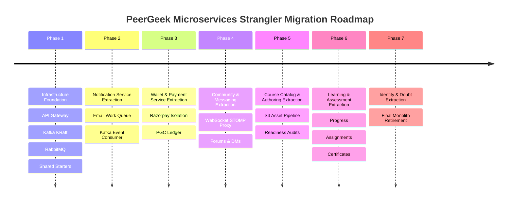

# Document 10: Seven-Phase Migration Roadmap (Strangler Pattern)

## 1. Strangler Fig Migration Strategy

The migration from PeerGeek's Spring Boot monolith to autonomous microservices employs the **Strangler Fig Application Pattern**. Rather than a high-risk "big bang" rewrite, functionality is incrementally extracted into new services while the existing monolith continues to process production traffic.

The API Gateway routes traffic progressively to extracted services. If any extracted service encounters unexpected issues, the Gateway can instantly revert route definitions back to the monolith within seconds without data corruption.

---

## 2. Phase-by-Phase Extraction Blueprint

### Phase 1: Infrastructure Foundation & Gateway Establishment
- **Scope**: Establish distributed runtime infrastructure without touching existing business logic.
- **Components Built**:
  - `peergeek-gateway` (Spring Cloud Gateway on port 8080).
  - Local Kafka cluster in KRaft mode and RabbitMQ with Management UI.
  - Shared Maven libraries: `peergeek-common` (error models, DTOs, CloudEvents envelope) and `peergeek-security-starter` (reactive & servlet JWT claims verification).
- **Traffic Routing**: Gateway initially routes 100% of `/api/v1/**` and `/ws/**` traffic directly to the existing monolith (moved to internal port 8089).
- **Frontend Changes**: Point Vite proxy target to Gateway (8080). Zero frontend UI code modified.
- **Verification**: All existing 238 frontend vitest tests and 53 backend JUnit tests pass through Gateway.
- **Rollback Strategy**: Re-point Vite proxy directly back to monolith port 8089.

---

### Phase 2: Notification Service Extraction
- **Functionality Extracted**: In-app notifications, unread notification counter, email template dispatch via SMTP/Mailpit.
- **Why First?**: Notification Service is a pure terminal consumer with zero upstream callers. It cannot break core learning or payment flows, making it the safest service to validate the Kafka event bus and RabbitMQ queues in production.
- **Database Migration**:
  - Create schema `peergeek_notification`.
  - Copy `notifications` table data.
- **Kafka Events Consumed**: `UserRegistered`, `CourseCompleted`, `PaymentCaptured`.
- **RabbitMQ Queues Introduced**: `task.email.dispatch`.
- **Gateway Routing Cutover**:
  - `GET /api/v1/notifications/**` &rarr; `notification-service:8087`
  - `PATCH /api/v1/notifications/{id}/read` &rarr; `notification-service:8087`
- **Rollback Strategy**: Switch Gateway route `/api/v1/notifications/**` back to monolith; monolith resumes reading from `peergeek.notifications`.

---

### Phase 3: Wallet & Payment Service Extraction
- **Functionality Extracted**: PGC GeekCoins balance tracking, reservation and release, Razorpay recharge orders, checkout signature verification, and webhook handling.
- **Why Phase 3?**: Isolates real-money payment credentials and financial transactions into an autonomous service with dedicated ACID guarantees.
- **Database Migration**:
  - Create schema `peergeek_wallet`.
  - Migrate `wallets`, `wallet_transactions`, and `payment_orders`.
- **REST Contracts Introduced**:
  - `POST /api/v1/internal/wallet/reservations` (for Doubt Session Service).
- **Kafka Events Published**: `PaymentCaptured`, `WalletCredited`.
- **Kafka Events Consumed**: `UserRegistered` (auto-provisions wallet), `ReferralRewarded`.
- **Gateway Routing Cutover**:
  - `/api/v1/wallet/**` &rarr; `wallet-service:8084`
  - `POST /api/v1/payments/razorpay/webhook` &rarr; `wallet-service:8084`
- **Rollback Strategy**: Gateway re-points `/api/v1/wallet/**` to monolith. Dual-write synchronization script reconciles any payments captured during the transition window.

---

### Phase 4: Community & Messaging Service Extraction
- **Functionality Extracted**: Discussion posts, comments, `@mentions`, domain chat, global campus chat, 1-on-1 direct messages, and STOMP WebSockets (`/ws`).
- **Why Phase 4?**: Real-time WebSocket connections and chat messages have distinct high-concurrency scaling needs separate from course authoring.
- **Database Migration**:
  - Create schema `peergeek_community`.
  - Migrate 8 community and direct messaging tables.
- **WebSocket Routing**:
  - Gateway proxies `ws://localhost:8080/ws` to `ws://community-service:8086/ws`.
- **REST Contracts**:
  - Calls Identity Service `POST /api/v1/internal/users/batch-profiles` for participant metadata.
- **Rollback Strategy**: Gateway reverts `/ws` and `/api/v1/community/**` to monolith.

---

### Phase 5: Course Catalog & Authoring Service Extraction
- **Functionality Extracted**: Categories, courses, topics, modules, lessons, lesson contents, presigned S3 resource uploads, readiness checks.
- **Database Migration**:
  - Create schema `peergeek_course`.
  - Migrate 13 course, lesson, module, resource, and readiness tables.
- **RabbitMQ Queues Introduced**:
  - `task.video.process` (FFmpeg transcoding).
  - `task.image.resize` (Thumbnail processing).
- **Kafka Events Published**:
  - `CoursePublished` (with complete course snapshot).
  - `CourseUnpublished`, `CourseContentChanged`.
- **Gateway Routing Cutover**:
  - `/api/v1/instructor/courses/**` &rarr; `course-service:8082`
  - `/api/v1/categories/**` &rarr; `course-service:8082`

---

### Phase 6: Learning & Assessment Service Extraction
- **Functionality Extracted**: Course enrollments, lesson progress tracking, assignment taking, submission grading, certificate generation, bookmarks, and lesson notes.
- **Why Kept Together?**: As established in Document 2 & 3, certificate eligibility requires synchronous evaluation of both 100% lesson progress and passing grades on mandatory assignments. Keeping them in the same service avoids distributed multi-phase transactions.
- **Database Migration**:
  - Create schema `peergeek_learning`.
  - Migrate 11 learning, assignment, submission, and certificate tables.
- **Kafka Events Published**: `LessonCompleted`, `CourseCompleted`, `AssignmentGraded`.
- **RabbitMQ Queues Introduced**: `task.pdf.certificate` (OpenPDF certificate generator).
- **Gateway Routing Cutover**:
  - `/api/v1/learning/**` &rarr; `learning-service:8083`
  - `/api/v1/certificates/**` &rarr; `learning-service:8083`

---

### Phase 7: Identity Service, Doubt Session Service & Monolith Retirement
- **Functionality Extracted**:
  - Identity Service: User authentication, registration, profiles, password reset (`peergeek_identity`).
  - Doubt Session Service: LiveKit Cloud WebRTC integration, instructor availability schedules (`peergeek_doubtsession`).
  - Analytics & Discovery Service: Public search index, reviews, instructor telemetry (`peergeek_discovery`).
- **Final Monolith Retirement**:
  - All routes now terminate at autonomous microservices.
  - Monolith process is shut down.
  - Old `peergeek` monolithic database is backed up, archived to cold storage, and decommissioned.
  - Zero monolithic dependencies remain.

---

## 3. Risk Matrix & Mitigation Blueprint

| Technical Risk | Impact | Probability | Mitigation Strategy |
| :--- | :---: | :---: | :--- |
| **Distributed Transaction Failure (Doubt Booking)** | High | Medium | Use synchronous fund reservation with strict 2-second timeout and idempotency key. Settle payouts via transactional outbox Kafka events. |
| **Data Drift During Database Split** | High | Low | Validate checksums and record counts via verification scripts before cutover. Maintain dual-write or audit log verification. |
| **WebSocket Disconnects During Cutover** | Medium | Medium | Frontend STOMP client auto-reconnects with exponential backoff; authentication handled transparently via refresh token. |
| **Kafka Event Loss / Poison Pills** | High | Low | Implement Transactional Outbox Pattern for publishing and Dead-Letter Topics (DLT) with 3x retry on consumers. |
| **Service Latency Compounding** | Medium | Medium | Enforce maximum call depth of 1 hop. Use Redis caching for public course and user profile reads. |
| **Developer Complexity Overhead** | Medium | High | Provide single-command local development setup via Docker Compose profiles (`docker compose --profile core up`). |

