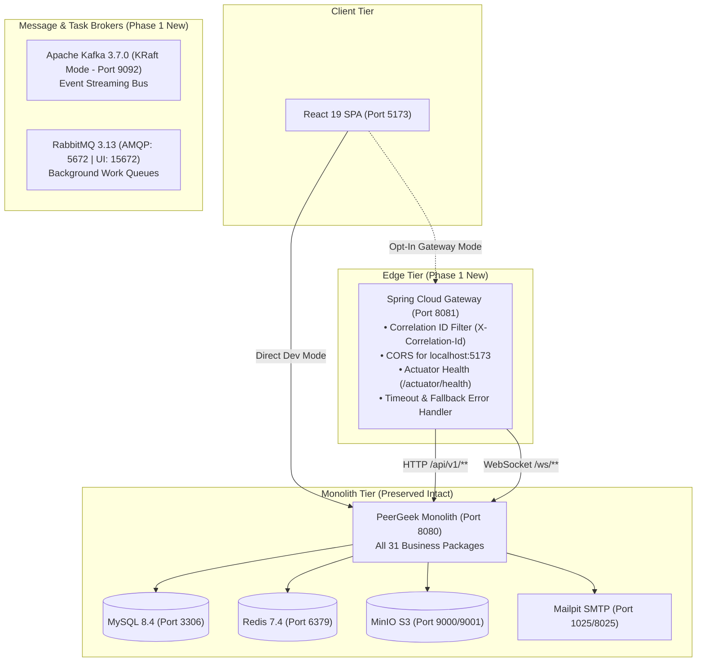

# Phase 1: Infrastructure Foundation Implementation Report

## 1. Executive Summary

As part of PeerGeek's gradual migration from a modular monolith to a distributed microservices architecture (Strangler Fig Pattern), **Phase 1: Infrastructure Foundation** has been successfully designed, implemented, and verified.

This phase establishes the shared runtime infrastructure—**Spring Cloud API Gateway**, **Apache Kafka** in KRaft mode, and **RabbitMQ** with Management UI—without modifying or destabilizing existing business logic or database schemas. All existing monolithic capabilities, authentication mechanisms, and test suites remain 100% operational.

---

## 2. Infrastructure Architecture Overview



---

## 3. Implemented Components

### 3.1. Spring Cloud API Gateway (`api-gateway/`)
- **Technology Stack**: Spring Boot 3.4.3, Spring Cloud Gateway 2024.0.0, Project Reactor, Netty.
- **Port Allocation**: Runs on port `8081` (configurable via `GATEWAY_PORT`).
- **Transitional Routing**:
  - Route `monolith-api`: Forwards `/api/v1/**` to `${MONOLITH_BASE_URL:http://localhost:8080}`.
  - Route `monolith-ws`: Forwards `/ws/**` to `${MONOLITH_WS_URL:ws://localhost:8080}`.
- **Authentication & Headers**:
  - Client `Authorization: Bearer <token>` headers are preserved and forwarded transparently to the monolith.
- **Distributed Tracing & Correlation ID**:
  - Implemented `CorrelationIdFilter`:
    - Checks for incoming `X-Correlation-Id` header.
    - If absent, generates a high-entropy UUID.
    - Injects `X-Correlation-Id` into downstream request and adds it to client response headers.
- **Cross-Origin Resource Sharing (CORS)**:
  - Configured globally for `http://localhost:5173`.
  - Supports methods: `GET, POST, PUT, DELETE, PATCH, OPTIONS`.
  - `allowCredentials: true` enabled for cookie and JWT credential workflows.
- **Resilience & Timeouts**:
  - Connect timeout: `5000ms`.
  - Downstream response timeout: `10000ms`.
- **Centralized Error Fallback**:
  - Implemented `GatewayExceptionHandler` (`WebExceptionHandler`):
    - Translates downstream connectivity failures (`ConnectException`) into structured HTTP 503 Service Unavailable JSON.
    - Translates downstream timeouts (`TimeoutException`) into HTTP 504 Gateway Timeout JSON.
    - Standard JSON payload includes: `status`, `error`, `message`, `path`, `timestamp`, and `X-Correlation-Id`.
- **Actuator Health**:
  - Health endpoint exposed at `/actuator/health` with readiness and liveness probes enabled.

### 3.2. Apache Kafka in KRaft Mode
- **Image**: `apache/kafka:3.7.0`.
- **Mode**: KRaft (single-node, controller + broker in a single process, Zookeeper-free).
- **Port**: `9092` exposed to host and container network.
- **Persistent Storage**: Named volume `kafka-data:/var/lib/kafka/data`.
- **Health Check**: Native `kafka-broker-api-versions.sh` health probe.

### 3.3. RabbitMQ with Management UI
- **Image**: `rabbitmq:3.13-management-alpine`.
- **Ports**:
  - AMQP Protocol: `5672`.
  - Web Management Dashboard: `15672`.
- **Credentials**: Developer credentials configurable via `RABBITMQ_USER` / `RABBITMQ_PASS` (defaults to `peergeek_dev` / `peergeek_pass`).
- **Persistent Storage**: Named volume `rabbitmq-data:/var/lib/rabbitmq`.
- **Health Check**: `rabbitmq-diagnostics -q ping`.

### 3.4. Frontend Opt-In Configuration (`frontend/vite.config.js`)
- Updated Vite proxy configuration to dynamically inspect `process.env.VITE_GATEWAY_URL`.
- Default target: `http://localhost:8080` (zero impact on existing development workflow).
- Opt-in target: Set `VITE_GATEWAY_URL=http://localhost:8081` to route frontend API calls and WebSocket connections through the API Gateway.

---

## 4. Verification and Test Results

### 4.1. API Gateway Test Suite (JUnit 5 + WebTestClient)
Command executed:
```powershell
.\mvnw.cmd -f api-gateway/pom.xml test
```
**Results**:
- `contextLoads`: **PASSED** (Spring context, RouteLocator, and CorrelationIdFilter beans verified).
- `actuatorHealthReturnsUp`: **PASSED** (`/actuator/health` returns HTTP 200 with `status: UP`).
- `correlationIdGeneratedWhenMissing`: **PASSED** (Gateway generates valid UUID in `X-Correlation-Id`).
- `correlationIdPreservedWhenSupplied`: **PASSED** (Gateway retains caller's correlation ID).
- `downstreamUnreachableReturnsServiceUnavailableJson`: **PASSED** (Returns structured 503 JSON when downstream service is unreachable).
- **Summary**: `5 tests run, 0 failures, 0 errors, BUILD SUCCESS`.

### 4.2. Frontend Test Suite (Vitest)
Command executed:
```powershell
npm --prefix frontend test -- --run
```
**Results**:
- Test Files: **30 passed** (30)
- Tests: **242 passed** (242)
- Zero regressions in existing components, authentication, forms, certificates, reviews, or wallet badges.

### 4.3. Backend Monolith Compilation
Command executed:
```powershell
.\mvnw.cmd -f backend/pom.xml test-compile
```
**Results**:
- 586 main classes and 89 test classes compiled with **BUILD SUCCESS**.

### 4.4. Docker Compose Configuration Validation
Command executed:
```powershell
docker compose config --quiet
```
**Results**:
- Validated without syntax or dependency errors.

---

## 5. Configuration Reference (`.env.example`)

The following variables have been documented in `.env.example`:

| Environment Variable | Default Value | Description |
| :--- | :--- | :--- |
| `GATEWAY_PORT` | `8081` | Spring Cloud Gateway listening port |
| `MONOLITH_BASE_URL` | `http://localhost:8080` | Downstream monolith HTTP URL |
| `MONOLITH_WS_URL` | `ws://localhost:8080` | Downstream monolith WebSocket URL |
| `KAFKA_BOOTSTRAP_SERVERS` | `localhost:9092` | Kafka broker bootstrap address |
| `KAFKA_ADVERTISED_HOST` | `localhost` | Kafka advertised listener hostname |
| `RABBITMQ_HOST` | `localhost` | RabbitMQ host |
| `RABBITMQ_PORT` | `5672` | RabbitMQ AMQP port |
| `RABBITMQ_MGMT_PORT` | `15672` | RabbitMQ management dashboard port |
| `RABBITMQ_USER` | `peergeek_dev` | RabbitMQ default administrative username |
| `RABBITMQ_PASS` | `peergeek_pass` | RabbitMQ default administrative password |
| `VITE_GATEWAY_URL` | `http://localhost:8081` | Frontend opt-in proxy destination |

---

## 6. Runbook & Operational Procedures

### Starting the Infrastructure Services
To launch the message brokers and gateway in Docker Compose:
```bash
# Start background infrastructure (MySQL, Redis, MinIO, Mailpit, Kafka, RabbitMQ)
docker compose up -d mysql redis minio minio-init mailpit kafka rabbitmq

# Verify health status of all containers
docker compose ps
```

### Running the API Gateway Locally
```bash
# Using the Maven wrapper in the api-gateway directory
cd api-gateway
./mvnw spring-boot:run

# Or run the packaged JAR directly
java -jar api-gateway/target/api-gateway-0.0.1-SNAPSHOT.jar
```

### Checking RabbitMQ Management Dashboard
Open `http://localhost:15672` in a browser. Log in with `peergeek_dev` / `peergeek_pass`.

### Rollback Strategy
If issues arise while routing traffic through the API Gateway:
1. In `frontend/vite.config.js` or environment, unset `VITE_GATEWAY_URL` (or set to `http://localhost:8080`).
2. Frontend immediately resumes direct communication with the monolithic backend without any downtime or data inconsistency.

