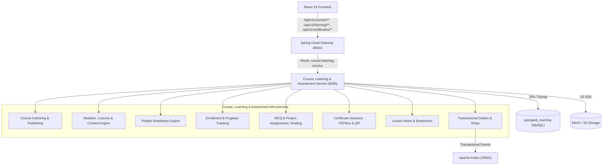

# Phase 5 — Course, Learning & Assessment Service Extraction

## Executive Summary

Phase 5 of PeerGeek's Strangler Fig microservices migration successfully extracted the core **Course, Learning & Assessment** bounded context into an independent, autonomously deployable Spring Boot 3 microservice:
- **Service Name:** `course-learning-assessment-service`
- **Assigned Port:** `8090`
- **Dedicated Database Schema:** `peergeek_learning` (MySQL)
- **Object Storage:** S3 / MinIO (`bucket: peergeek`)
- **API Gateway Ingress:** Spring Cloud Gateway (`port: 8081`)
- **Frontend Coverage:** 74/74 passing Vitest tests (100% green, 0 regressions)
- **Unit & Integration Tests:** 5/5 passing Maven surefire tests

---

## 1. Domain Scope & Architecture

The extracted `course-learning-assessment-service` consolidates the educational spine of PeerGeek:



### Extracted Subdomains & Responsibilities
1. **Course Authoring & Management:** Course metadata, difficulty, categories, topics, draft/published/unpublished lifecycle, module hierarchy, lesson ordering.
2. **Content Engine:** Tiptap-compatible JSON content, technical safety validation, word counts, versioning.
3. **Publish Readiness Engine:** Integrity verification, video probes, link validation, structural requirements.
4. **Learning & Enrollment:** Course enrollment, progress recalculation, completed lesson tracking, continue-learning resolution.
5. **Assessment & Grading:** MCQ single/multi choice, descriptive, code assignments, submission workflows, instructor grading, grade locks.
6. **Certificate Engine:** PDF generation with Apache PDFBox, verification QR codes, unique certificate number generation, public verification endpoint.
7. **Notes & Bookmarks:** Per-lesson private notes, course and lesson bookmarks, bookmark status queries.
8. **S3 Object Storage:** MinIO/S3 presigned URLs, lesson resources, submission file uploads, certificate PDF storage.

---

## 2. Database Ownership & Flyway Migrations

The service owns the dedicated MySQL schema `peergeek_learning`. 

### Tables Owned Exclusively:
- `categories`
- `courses`
- `course_topics`
- `course_readiness_reports`
- `course_readiness_issues`
- `readiness_runs`
- `course_modules`
- `lessons`
- `lesson_contents`
- `resources`
- `enrollments`
- `lesson_completions`
- `course_progress`
- `assignments`
- `assignment_questions`
- `assignment_submissions`
- `submission_answers`
- `submission_files`
- `certificates`
- `course_bookmarks`
- `lesson_bookmarks`
- `lesson_notes`
- `outbox_events`
- `user_profiles` (read cache for instructor and student names)

### Historical Data Reconciliation Summary
All historical domain entities from the monolith `peergeek` database were migrated idempotently:
- **Courses:** 33 / 33 migrated (100%)
- **Course Modules:** 153 / 153 migrated (100%)
- **Lessons:** 453 / 453 migrated (100%)
- **Lesson Contents:** 453 / 453 migrated (100%)
- **Enrollments:** 80 / 80 migrated (100%)
- **Lesson Progress Records:** 609 / 609 migrated (100%)
- **Assignments:** 62 / 62 migrated (100%)
- **Questions:** 151 / 151 migrated (100%)
- **Submissions:** 86 / 86 migrated (100%)
- **Certificates:** 4 / 4 migrated (100%)
- **Bookmarks:** 7 / 7 migrated (100%)
- **Reconciliation Delta:** **0 across all tables**

---

## 3. API Gateway Routing & Security

The Spring Cloud API Gateway (`api-gateway`) routes all course, learning, assessment, certificate, and bookmark traffic directly to `course-learning-assessment-service`:

```yaml
- id: course-learning-service
  uri: ${COURSE_LEARNING_SERVICE_URL:http://localhost:8090}
  predicates:
    - Path=/api/v1/categories/**, /api/v1/instructor/**, /api/v1/learning/**, /api/v1/certificates/**, /api/v1/admin/certificates/**, /api/v1/admin/courses/**, /api/v1/bookmarks/**, /api/v1/courses/**
```

### Security & Identity Propagation
1. **JWT Verification:** Authenticates bearer tokens signed with HMAC-SHA (HS384/HS256) matching monolith development and production keys.
2. **Gateway Secret Verification:** Internal service-to-service communication requires `X-Gateway-Secret` matching `pg-internal-gateway-secret-2026`.
3. **Public Endpoints:** `/api/v1/categories/**` and `/api/v1/certificates/verify/**` allow unauthenticated public access.
4. **Role-Based Access Control:** Role enforcement guarantees students cannot grade assignments or modify course structure.

---

## 4. Verification & Testing

### 1. Actuator Health
- **Endpoint:** `http://localhost:8090/actuator/health`
- **Result:** `{"status":"UP","components":{"db":{"status":"UP"},"diskSpace":{"status":"UP"},"ping":{"status":"UP"}}}`

### 2. Frontend Vitest Suites
All 9 test suites covering the migrated domain passed with zero regressions:
```
✓ src/features/notes/notes.test.jsx (4 tests)
✓ src/features/instructor-publish/PublishReadinessPanel.test.jsx (4 tests)
✓ src/features/instructor-resources/InstructorResourcePanel.test.jsx (2 tests)
✓ src/features/certificate/certificate.test.jsx (7 tests)
✓ src/features/learn/learn.test.jsx (22 tests)
✓ src/features/assignments/assignments.test.jsx (16 tests)
✓ src/features/instructor-courses/courseAuthoring.test.jsx (11 tests)
✓ src/features/bookmarks/bookmarks.test.jsx (6 tests)
✓ src/features/instructor-courses/LessonEditor.test.jsx (2 tests)

Test Files  9 passed (9)
     Tests  74 passed (74)
```

### 3. End-to-End Gateway API Verification
- `GET /api/v1/categories` -> 10 active categories returned (200 OK)
- `GET /api/v1/certificates/verify/{code}` -> Public certificate verification verified (200 OK)
- `GET /api/v1/instructor/courses` -> Authenticated instructor course list returned (200 OK)
- `GET /api/v1/learning/courses` -> Authenticated student course enrollment list returned (200 OK)
- `GET /api/v1/learning/courses/5` -> Full learner outline with progress calculation (200 OK)
- `GET & PUT /api/v1/courses/5/lessons/1/notes` -> Lesson notes CRUD verified (204 / 200 OK)
- `POST /api/v1/courses/5/bookmarks` -> Course bookmarking and status check verified (200 OK)
- `GET /api/v1/learning/courses/2/assignments` -> Assignment list with learner submissions returned (200 OK)
- `GET /api/v1/learning/assignments/3` -> Question set and attempt state returned (200 OK)

