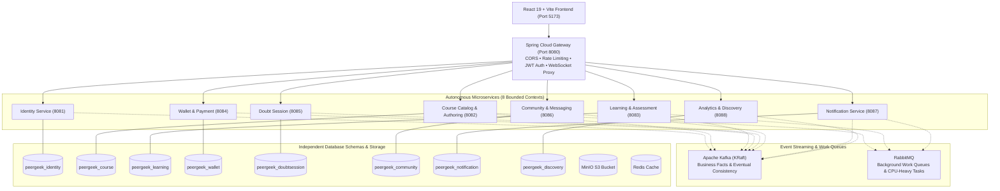

# PeerGeek — Microservices Architecture & Migration Blueprint

Welcome to the **PeerGeek Microservices Architecture and Migration Documentation Package (Phase 0)**.

This documentation package provides the complete architectural audit, bounded context definitions, database ownership models, asynchronous event catalogues, work queue specifications, and the seven-phase Strangler Fig migration roadmap for transitioning PeerGeek from its current Spring Boot modular monolith to an autonomous, distributed microservices architecture.

---

## 📚 Document Index

| Document | Title | Core Focus |
| :---: | :--- | :--- |
| **01** | [**Current Architecture Assessment**](./01-current-architecture-assessment.md) | Exhaustive inventory of all 31 monolithic packages, controllers, services, entities, tables, and infrastructure dependencies. |
| **02** | [**Service Boundary Design**](./02-service-boundary-design.md) | Bounded contexts, DDD rationale, evaluation of candidate services, and justification for 8 core microservices. |
| **03** | [**Dependency and Coupling Analysis**](./03-dependency-and-coupling-analysis.md) | Static code audit of cross-module injections, circular risks, `UserEntity` coupling, and decoupling strategies. |
| **04** | [**Database Ownership & Migration Plan**](./04-database-ownership-and-migration-plan.md) | Table assignment across 8 schemas, foreign key replacement with logical IDs, and zero-data-loss migration strategy. |
| **05** | [**REST API Communication Design**](./05-rest-api-communication-design.md) | Synchronous service-to-service contracts, schemas, timeouts, idempotency keys, and Resilience4j circuit breakers. |
| **06** | [**Kafka Event Architecture**](./06-kafka-event-architecture.md) | Apache Kafka in KRaft mode, event catalog (CloudEvents format), partitioning keys, consumer groups, retention, and dead-letter topics. |
| **07** | [**RabbitMQ Architecture**](./07-rabbitmq-architecture.md) | Task distribution vs event streaming, email queue, FFmpeg video transcoding, image optimization, and PDF rendering. |
| **08** | [**Gateway, Security & WebSocket Design**](./08-gateway-security-and-websocket-design.md) | Spring Cloud Gateway routing, JWT verification, identity propagation headers, defense-in-depth, and STOMP `/ws` proxying. |
| **09** | [**Infrastructure & Deployment Design**](./09-infrastructure-and-deployment-design.md) | Local development Docker Compose topology, port allocations, networks, health checks, and OpenTelemetry distributed tracing. |
| **10** | [**Seven-Phase Migration Roadmap**](./10-seven-phase-migration-roadmap.md) | Strangler Fig roadmap from Phase 1 (Infra Foundation) to Phase 7 (Monolith Retirement), risk matrix, and rollback plans. |
| **11** | [**Phase 1 Infrastructure Implementation**](./PHASE_1_INFRASTRUCTURE.md) | Implementation report for Spring Cloud Gateway, Kafka KRaft, RabbitMQ, and transitional routing. |
| **12** | [**Phase 2 Notification Service Extraction**](./PHASE_2_NOTIFICATION_SERVICE.md) | Autonomous Notification microservice, isolated schema, Outbox pattern, Kafka consumers, RabbitMQ email tasks, and Gateway routing. |
| **13** | [**Phase 3 Wallet & Payment Service Extraction**](./PHASE_3_WALLET_PAYMENT_SERVICE.md) | Autonomous Wallet & Payment microservice, independent schema, Razorpay integration, Transactional Outbox, Kafka publishers, and Gateway routing. |
| **14** | [**Phase 4 Community Service Extraction**](./PHASE_4_COMMUNITY_SERVICE.md) | Autonomous Community microservice, isolated schema (`peergeek_community`), STOMP WebSocket messaging, domain & global chats, posts, comments, mentions, Transactional Outbox, and Notification integration. |
| **15** | [**Phase 5 Course, Learning & Assessment Service Extraction**](./PHASE_5_COURSE_LEARNING_ASSESSMENT_SERVICE.md) | Autonomous Course, Learning & Assessment microservice, dedicated schema (`peergeek_learning`), MinIO/S3 object storage, course authoring, progress recalculation, MCQ assessments, certificate generation (PDFBox), lesson notes, bookmarks, and Gateway routing. |

---

## 🏛️ High-Level Target Architecture Overview

